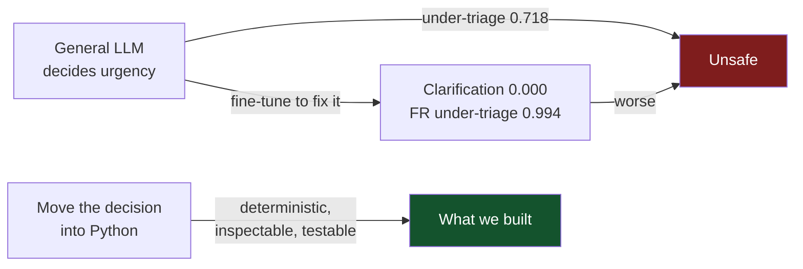
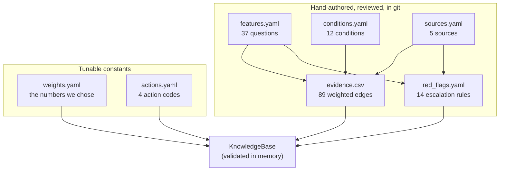
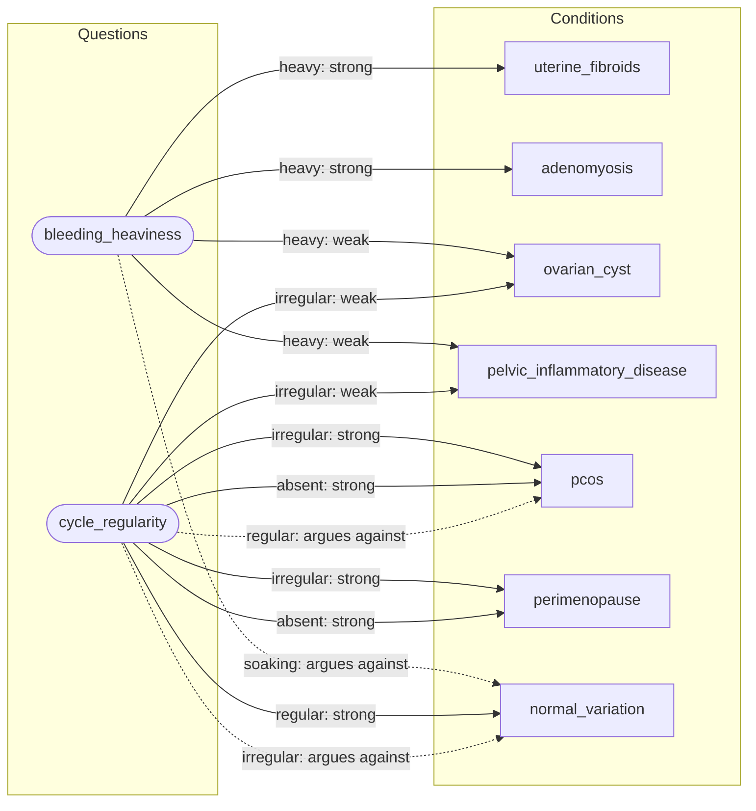
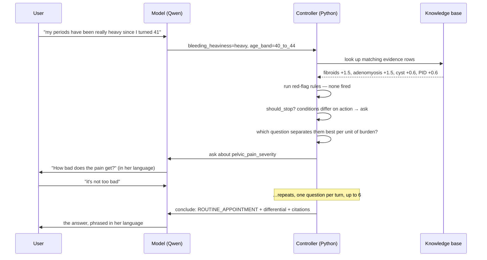
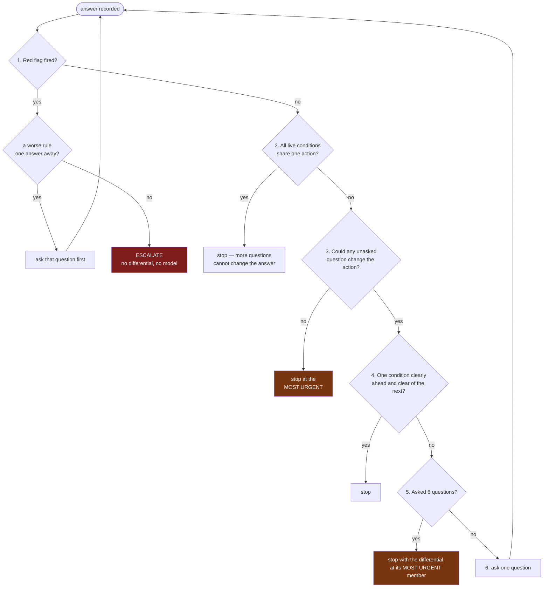
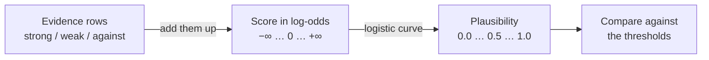
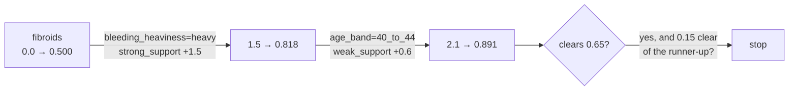
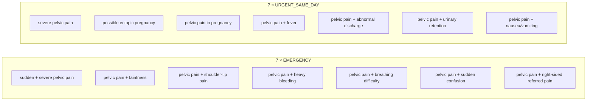
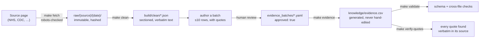

# The knowledge base, explained

**Audience:** supervisor, mentors, teammates, and anyone marking this.
**Question it answers:** how does a sentence typed by a user become "see a GP
this week", and how do we know that answer is not made up?

Everything here is generated from the real files. Numbers current at
2026-08-04: **37 features, 12 conditions, 89 evidence rows, 14 red-flag rules,
5 sources, 103/103 quotes verified.**

---

## 1. The one-paragraph version

The system never asks a language model what is wrong with someone. Instead we
hand-authored a small graph: **questions** on one side, **conditions** on the
other, and **weighted edges** between them, where every edge is a restatement of
a sentence from a named medical source. A plain-Python controller walks that
graph — it adds up evidence, decides which question would best separate the
conditions still in play, and stops when no further question could change the
advice. The model's only jobs are turning what a user wrote into answers, and
turning the controller's decision into a sentence in her language.

---

## 2. Why it is built this way

We evaluated a general multilingual model on a 540-case benchmark of women's
health concerns first. What we found is the reason for every design choice
below:

| Finding | Number |
|---|---|
| English **under-triage** — cases needing a doctor sent to "routine" | **0.718** |
| Aggregate risk accuracy | 0.667 *(majority-class baseline: 0.644)* |
| Clarification-seeking, after fine-tuning | 0.856 → **0.000** |
| French/Arabic under-triage, after fine-tuning | **0.994** |
| Cross-language consistency, during that collapse | **improved** |

Read the last two rows together. Fine-tuning made the model answer "routine" for
538 of 540 French cases — and *consistency went up*, because the model had
collapsed onto one answer. **A system that says the same thing to everyone
scores perfectly on consistency.** That is why consistency is never reported on
its own here.



Three consequences, all binding:

1. **No fine-tuning in the MVP.** Retrieval plus a deterministic controller.
2. **The triage decision lives in Python**, not in the model or the prompt.
3. **Under-triage is the dominant failure mode.** Every tie goes to caution.

---

## 3. The seven files



| File | What it is | Rule that governs it |
|---|---|---|
| `features.yaml` | Everything we may **ask** | A feature is a question, not a claim — so it needs no source |
| `conditions.yaml` | Everything we may **suspect** | Two sources each, or a written reason why not |
| `evidence.csv` | The sparse grid **connecting them** | Every row carries a source and a verbatim quote |
| `red_flags.yaml` | Deterministic **escalation** | Derived only from explicit escalation language, never inferred |
| `sources.yaml` | Provenance, licence, precedence | Only usable sources are listed at all |
| `weights.yaml` | Ordinal → log-odds | **Every number chosen by us.** Not calibrated. Not citable |
| `actions.yaml` | The four action codes | Severity strictly increasing |

---

## 4. The graph — this is the "reason like a doctor" part

Conditions and questions are nodes. Evidence rows are typed, weighted edges.

Here is a real slice of it: everything connected to **`bleeding_heaviness`** and
**`cycle_regularity`**, the two most connected questions in the base. Every edge
below is an actual row in `evidence.csv`.



Read it as a clinician would: *heavy bleeding* pulls four conditions up and
pushes "normal" down. *Regular cycles* pull "normal" up and push PCOS down.
Asking one question moves several conditions at once, in different directions —
that is what makes a question worth asking.

### The five edge types, and nothing else

| Strength | Log-odds | When a row gets it |
|---|---|---|
| `strong_support` | **+1.5** | A source calls it a main or characteristic sign |
| `weak_support` | **+0.6** | A source lists it among the condition's features |
| `neutral` | 0.0 | **Omit the row.** Sparse by design — 37 × 12 = 444 cells, only 89 filled |
| `argues_against` | **−0.5** | A source explicitly frames it as distinguishing or excluding |
| `rules_out` | **−4.0** | Enough on its own to drop below the floor |

`argues_against` is deliberately *weaker* than `weak_support`. The system should
accumulate belief faster than it eliminates, because wrongly dropping a
condition costs more than asking one more question.

### The most connected questions

| Question | Conditions it touches |
|---|---|
| `bleeding_heaviness` | 5 |
| `pelvic_pain_severity` | 5 |
| `cycle_regularity` | 5 |
| `difficulty_conceiving` | 5 |
| `pain_opening_bowels_or_urinating` | 5 |
| `abnormal_discharge` | 4 |
| `pain_with_sex` | 4 |
| `urinary_symptoms` | 4 |

---

## 5. How a consultation runs



**The model never decides anything.** It converts prose into feature values on
the way in, and structure into prose on the way out. Everything between those
two arrows is deterministic Python that produces the same answer every time.

---

## 6. The stopping controller — six rules, in order

The order *is* the policy. First match wins.



**Three places the design chooses caution, highlighted above:**

1. An unresolved differential returns its **most urgent** member's action — not
   its most likely one. A differential holding both "normal variation" and
   "pelvic inflammatory disease" must not be reported as self-care because the
   benign one happened to score higher.
2. Concluding `SELF_CARE` requires clearing a **strictly higher** bar (0.85) than
   any other action (0.65). "Nothing to do" is the conclusion most costly to get
   wrong, so it is the hardest to reach.
3. A fired red flag does not conclude while a **more severe** rule is one unasked
   answer away. Otherwise a one-clause `URGENT_SAME_DAY` rule pre-empts the
   `EMERGENCY` rule sitting one question behind it — which is a real bug we hit
   and fixed (ADR 0007).

---

## 6a. The numbers, explained

> **Read this first: none of these numbers is calculated.** Every one was chosen
> by us and then checked for internal consistency. There is no dataset behind
> them, no fitting procedure, no clinical validation. They are *defensible
> starting values* that the evaluation set is meant to move. `weights.yaml` says
> so at the top of the file so nobody quotes them as findings.
>
> What *is* principled is the **relationships between them**, and that is what
> this section explains.

### The one idea you need: log-odds

We need to answer "how much does this answer count?" in a way that lets several
answers add up. The obvious approach — percentages — breaks immediately:

> 60% + 60% = 120%. Nonsense.

So we score each condition on a scale where **adding works**, and only convert to
a human-readable 0–1 number at the very end. That scale is **log-odds**.



Three properties make it the right scale:

| Property | Why it matters |
|---|---|
| **0 means "no idea"** | A condition starts at 0, which converts to **0.5** — not favoured, not excluded. Starting at 0% would mean "already ruled out" before we asked anything |
| **Adding is meaningful** | Two pieces of evidence combine by `+`, and the result never leaves 0–1 after conversion |
| **It is symmetric** | +1.5 pushes up exactly as hard as −1.5 pushes down |

The conversion is one line, in [`scoring.py`](../packages/contracts/src/herhealth_contracts/scoring.py):

```python
plausibility = 1 / (1 + exp(-score))       # log-odds  → 0–1
score        = log(p / (1 - p))            # 0–1       → log-odds
```

Each condition is scored **independently** — this is not a softmax, so the twelve
conditions do not compete for a fixed total and *all of them can be implausible
at once*. That matters: a softmax would always float something to the top, even
for a user whose condition we do not model. See
[ADR 0005](adr/0005-plausibility-is-an-independent-logistic.md).

### The two scales, side by side

Thresholds are authored on the 0–1 scale because that is readable. The
controller adds on the log-odds scale. Here is the same set of numbers in both:

| | Plausibility | Log-odds | Meaning |
|---|---|---|---|
| `rules_out` | — | **−4.0** | A source says this excludes it |
| `plausibility_floor` | **0.05** | −2.94 | Below here, out of play |
| `argues_against` | — | **−0.5** | A source frames it as distinguishing |
| *(starting point)* | 0.50 | 0.00 | Nothing asked yet |
| `weak_support` | — | **+0.6** | Listed among the condition's features |
| `stop_confidence` | **0.65** | +0.62 | Bar to conclude — any action but self-care |
| `strong_support` | — | **+1.5** | A main or characteristic sign |
| `self_care_stop_confidence` | **0.85** | +1.73 | Bar to conclude "nothing to do" |

### What it takes to reach each bar

This is the table to look at when asking "is 1.5 too big?"

| Evidence gathered | Score | Plausibility | Effect |
|---|---|---|---|
| nothing | +0.0 | 0.500 | — |
| 1 × weak | +0.6 | 0.646 | just **under** the 0.65 bar |
| 2 × weak | +1.2 | 0.769 | clears the bar |
| **1 × strong** | **+1.5** | **0.818** | **clears the bar on its own** |
| 1 strong + 1 weak | +2.1 | 0.891 | clears the self-care bar too |
| 2 × strong | +3.0 | 0.953 | — |

And in the other direction, starting from zero:

| To eliminate a condition | Needs |
|---|---|
| using `argues_against` (−0.5) | **6 rows** |
| using `rules_out` (−4.0) | **1 row** |

Six-to-one is deliberate. **The system should gain belief faster than it loses
it**, because wrongly dropping a condition costs more than asking one more
question. That is the whole reason `argues_against` (−0.5) is weaker in
magnitude than `weak_support` (+0.6).

### Worked example

A user says her periods are heavy and she is 42.



Two answers, two rows, and the condition is at 0.891. Whether the controller
actually stops depends on rule 4 — it also needs `stop_margin` clearance over
the second-place condition, and here adenomyosis is at 0.818, only 0.073 behind.
So it keeps asking. That is the margin doing its job.

### The three rules the schema enforces

These are checked at load time, so a bad edit fails loudly rather than
silently changing behaviour:

1. **The scale must be monotonic.** `strong_support > weak_support > neutral >
   argues_against > rules_out`, with `neutral` pinned at exactly 0.0.
2. **`self_care_stop_confidence` must be strictly greater than
   `stop_confidence`.** Concluding "nothing to do" is the conclusion most costly
   to get wrong, so it must be the hardest to reach. The file cannot be saved
   with them equal.
3. **`rules_out` must at least reach the floor on its own.** Otherwise the name
   is a lie.

### Why these weights — the one-sentence answer

Because the sigmoid converts log-odds to probability, **adding weights is the
same as multiplying odds**. Every weight therefore has a plain reading:

| Weight | Value | In plain English |
|---|---|---|
| `strong_support` | **+1.5** | this finding makes the condition **≈ 4.5× more likely** |
| `weak_support` | **+0.6** | **≈ 1.8× more likely** |
| `neutral` | 0.0 | **× 1** — changes nothing, which is exactly why the row is omitted |
| `argues_against` | **−0.5** | **≈ 1.6× less likely** |
| `rules_out` | **−4.0** | **≈ 55× less likely** |

> *"A sign a source calls characteristic makes that condition about four and a
> half times more likely. A sign merely listed among its symptoms makes it about
> twice as likely."*

That is the whole justification, and it is checkable: `exp(1.5) = 4.48`.

### And the scale is conventional, not invented

Evidence-based medicine has long-standing bands for grading how much a
diagnostic finding shifts belief. Our five levels sit on them:

| Conventional band | Interpretation | Our weight |
|---|---|---|
| ≈ 2× | small but sometimes important increase | `weak_support` = **1.8×** ✓ |
| ≈ 5× | moderate increase | `strong_support` = **4.5×** ✓ |
| ≈ 10× | large, often conclusive | *deliberately unused — see below* |
| ≈ 0.5× | small decrease | `argues_against` = **0.61×** ✓ |
| < 0.1× | large decrease | `rules_out` = **0.018×** ✓ |

**We deliberately have no "conclusive" level.** The strongest positive evidence
this system can express is *moderate*, because a single sentence from a public
health page is not conclusive evidence of anything, and a system that could
reach certainty from one row would be over-claiming.

> ### The honesty line, and it matters
>
> We are **not** claiming heavy bleeding has a measured likelihood ratio of 4.5
> for fibroids. No source gives us that, and asserting it would be inventing a
> number — which this project forbids everywhere else.
>
> The claim is about the **ruler**, not any **measurement** made with it: the
> five-point ordinal scale is spaced according to a conventional grading of
> diagnostic evidence, rather than according to our taste. Individual rows stay
> ordinal — a row says `strong_support`, never `4.5`.

### Why this only works with a sigmoid, not a softmax

Under a **sigmoid** (independent logistic), each condition is scored on its own,
so `+1.5` always means "×4.5 more likely" no matter what else is in the
differential. The weights are *interpretable*.

Under a **softmax**, conditions compete for a fixed total. `+1.5` would mean
something different depending on what every other condition scored, the tables
above would be meaningless, and every threshold would need re-tuning each time a
condition was added. [ADR 0005](adr/0005-plausibility-is-an-independent-logistic.md)
rejected softmax on safety grounds — it cannot express "none of these fit". This
is the second reason.

### Where the thresholds came from

The weights have an external anchor. The thresholds do not — they are answers to
"how many findings should it take?", which is a question we can at least state
and argue about.

| Threshold | The requirement behind it |
|---|---|
| `plausibility_floor` **0.05** | A condition nobody has asked about must never drop out. Set low so rare conditions survive to be asked about |
| `stop_confidence` **0.65** | **One passing mention must never conclude a consultation.** So the bar sits above one `weak_support` row |
| `self_care_stop_confidence` **0.85** | Concluding "nothing to do" must need more than one characteristic sign. 72% of the original benchmark's failures were exactly this conclusion reached too easily — this is the most important number in the file |
| `stop_margin` **0.15** | Do not conclude while two conditions with *different actions* are neck and neck |
| `max_questions` **6** | How much patience a user has. A judgement, not a result |

### Checking the thresholds are not accidents

A threshold only means something relative to the scores evidence can actually
reach. With weights of +1.5 and +0.6, a condition can only ever land on sums of
those: 0.6, 1.2, 1.5, 1.8, 2.1 … A threshold sitting in a *gap* between two of
those has a clear meaning. A threshold sitting *just* above one has the same
meaning **by luck**, and a small edit elsewhere silently flips it.

`make thresholds` checks this. Run today, it reports:

```
  stop_confidence = 0.65  (+0.619 log-odds)
    means: more than 1×weak
    room below (1×weak): +0.019   ← FRAGILE
    room above (2×weak): +0.581
    robust alternative, equal room either side: 0.711
```

**`stop_confidence` clears "one weak row" by 0.019 log-odds — a 3% margin.** It
is enforcing the right requirement by accident. Raising `weak_support` from 0.6
to 0.62 would silently let a single passing mention end a consultation, and no
test would catch it.

`self_care_stop_confidence` is fragile in the other direction: only 0.065 above
it sits "3 × weak", so three passing mentions currently conclude self-care.

Both have robust alternatives — **0.711** and **0.839** — that sit midway
between reachable scores and enforce the same requirements with ~15× the margin.
They are *not applied yet*: changing a threshold changes every reported number,
and that belongs with the evaluation set, not in a documentation commit.

### Two known problems with these numbers

**1. One strong row can end a consultation.** A single `strong_support` reaches
0.818, clearing `stop_confidence` 0.65 on its own. That is probably too eager —
it risks concluding before reaching a question that would have changed the
action. Raising the bar toward 0.90 (roughly two rows) is the obvious candidate,
but the number should be set by the evaluation set rather than by argument.

**2. `rules_out` does not do what `weights.yaml` says it does.** The file claims
a single `rules_out` row eliminates a condition *"regardless of accumulated
support"*. It does not, because the weights simply add:

| Support already gathered | after `rules_out` (−4.0) | |
|---|---|---|
| nothing | −4.0 → 0.018 | eliminated |
| 1 weak (+0.6) | −3.4 → 0.032 | eliminated |
| 2 weak (+1.2) | −2.8 → 0.057 | **survives** |
| **1 strong (+1.5)** | **−2.5 → 0.076** | **survives** |
| 2 strong (+3.0) | −1.0 → 0.269 | **survives** |

`rules_out` only eliminates when prior support is below **+1.06 log-odds** — and
a single `strong_support` row already exceeds that. The schema check passes
because it only tests `rules_out` *from a standing start*, which is a weaker
condition than the sentence in the file.

This is currently harmless: the knowledge base has **zero** `rules_out` rows, so
nothing depends on it yet. It is recorded rather than quietly patched because
the fix is a real choice — see
[ADR 0009](adr/0009-rules-out-does-not-override-accumulated-support.md).

---

## 7. Red flags — 14 rules that outrank everything



Each rule is a **conjunction only** — an "or" is written as two rules, so each
one stays traceable to its own source sentence. Each carries the sentence it came
from. For example:

> `severe_pelvic_pain` → URGENT_SAME_DAY
> *"your pelvic pain or period pain is severe or worse than usual, and
> painkillers have not helped"* — NHS

**Red flags run before any scoring**, need no model call, and cannot be
suppressed by a confident differential. Red-flag recall is gated at 100% in CI
and is never traded against question count.

---

## 8. How we know the rows are not made up

**We do not have a clinician reviewer.** That is a resource constraint, and it
changes what the knowledge base is allowed to contain.

> **The rule: every row must be a restatement of something a cited source says.
> No row may be an independent clinical judgement by the team.**

This turns verification from a *medical* task into a *reading-comprehension*
task, which we can actually perform.



Four controls, all automated:

| Control | What it catches |
|---|---|
| `make validate` | Schema faults, broken references, illegal values |
| `make verify-quotes` | A quote that is not verbatim in the source it cites — **103/103 pass** |
| Generated CSV | Hand-edits that bypass review; the batch file is the only way in |
| Batch approval | More than 10 rows landing without a person reading them |

`verify-quotes` has already caught real errors: three quotes retyped from a
browser instead of the fetched document, and five where our own extractor
inserted a space before punctuation.

**Say this wherever results are reported:** the knowledge base is
*source-traceable* but **not clinician-adjudicated**. It is not validated,
expert-reviewed, or verified in a clinical sense.

---

## 9. Sources, and why only these five

| Source | Licence position | Use |
|---|---|---|
| [MedlinePlus](https://medlineplus.gov/) | Public domain, **except** the A.D.A.M. encyclopedia | Quote + ingest. `/ency/` blocked by path in code |
| [NICHD](https://www.nichd.nih.gov/) | US federal, public domain | Quote + ingest |
| [Office on Women's Health](https://womenshealth.gov/) | US federal, public domain | Quote + ingest — backs 30 of 89 rows |
| [CDC](https://www.cdc.gov/) | US federal, public domain | Quote + ingest |
| [NHS](https://www.nhs.uk/) | Crown copyright, **no reuse grant** | **Quote only.** Never enters the corpus |

NHS being quote-only is a licence constraint, not a fetching one, and it is
enforced by the validator rather than by memory. It matters because NHS backs
**37 of 89 evidence rows and all 14 red flags** — its "when to get help"
sections are the best escalation language available anywhere.

**Removed rather than listed:** NICE CKS (UK-only licence, forbids commercial
use, users are in Egypt), RCOG, ACOG, UMLS. They are absent from `sources.yaml`
entirely so nothing unusable can be cited by accident.

---

## 10. What the knowledge base cannot do

Stated plainly, because a limitation you name is a limitation you have handled.

- **Adenomyosis rests on one source.** NHS names it repeatedly alongside
  endometriosis; no second usable source has a dedicated page. Authored with a
  written exemption rather than silently.
- **Cancers are deliberately absent.** NHS names womb and ovarian cancer as
  causes of these presentations, but modelling them invites the system to raise
  cancer with a worried user. They are served by red flags instead —
  postmenopausal bleeding routes to a GP without ever naming why.
- **Elimination barely works.** Only 10 of 89 rows are eliminating, and 6 of
  those belong to `normal_variation`. Sources describe what conditions *cause*,
  rarely what argues against them. Consequence: conditions almost never leave
  the differential, so the controller currently over-triages heavily.
- **Two conditions are barely modelled.** `bacterial_vaginosis` has 1 row;
  `thrush` and `sexually_transmitted_infection` have 3 each.
- **Mid-range answers are invisible.** No row uses `pelvic_pain_severity:
  moderate` or `bleeding_heaviness: moderate`, so a user answering "moderate"
  moves no score at all.
- **Four conditions remain blocked** for lack of a second source: hyperprolactinaemia,
  endometrial polyp, pregnancy-related bleeding, and (partly) adenomyosis.

These are tracked in [ADR 0007](adr/0007-what-the-first-real-consultations-showed.md)
and are the input to the tuning work, not excuses.

---

## 11. Where to look next

| To understand | Read |
|---|---|
| The repository layout | [`REPO_MAP.md`](REPO_MAP.md) |
| What we are doing now and next | [`ROADMAP.md`](ROADMAP.md) |
| Every module in detail | [`CODE_GUIDE.md`](CODE_GUIDE.md) |
| Why a specific decision was made | [`adr/`](adr/) — eight records |
| The vocabulary | [`../CONTEXT.md`](../CONTEXT.md) |
