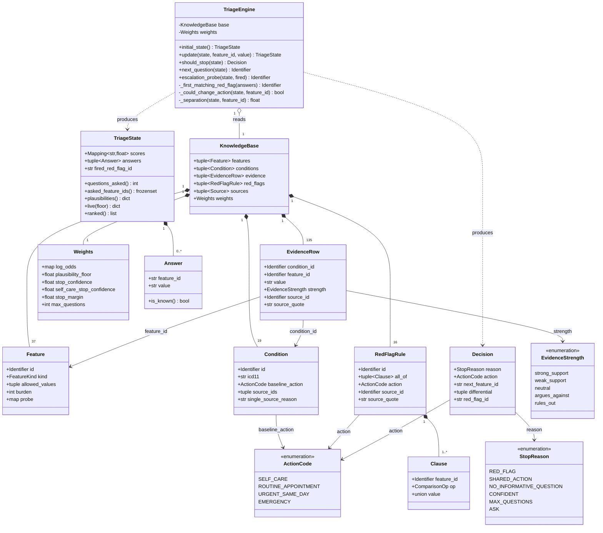
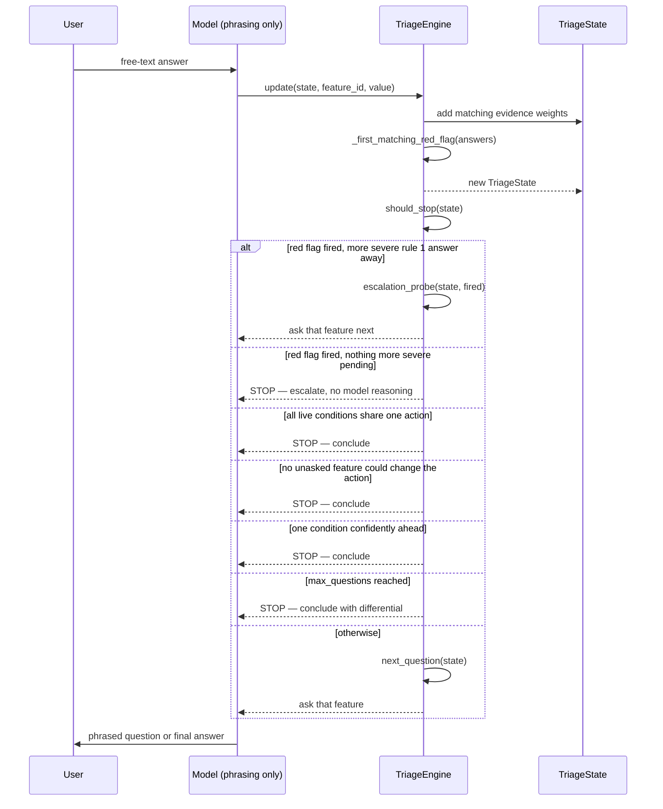
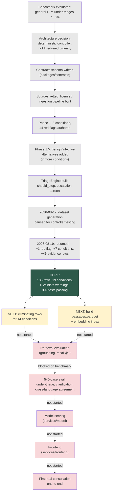

# HerHealthGPT — project status

Three things, in order: what the core system looks like (UML), what's built
versus what's next, and where we are in the overall build sequence.

Counts below are as of **2026-08-19** — the same date as `CLAUDE.md`. If you
change the knowledge base, update both files in the same commit.

---

## 1. UML — the triage core

This is the part of the system that actually runs today: load the knowledge
base, walk a consultation turn by turn, decide when to stop. Frontend, model
serving, and the eval harness's benchmark data are not shown — they either
don't exist yet or aren't what this document is about (see §2).

### Class diagram

**Reading it:** `KnowledgeBase` is loaded once, validated, and handed to
`TriageEngine`, which is stateless — every method takes a `TriageState` and
returns a new one or a `Decision`. Nothing mutates. `EvidenceRow` is the only
class with no surrogate key: its identity is the triple
`(condition_id, feature_id, value)`, enforced at load so the same cell can't
be asserted twice with different strengths.

### Sequence — one consultation turn

The model never appears left of `TriageEngine` in this diagram — it converts
prose to a `(feature_id, value)` pair on the way in, and a `Decision` to prose
on the way out. Every branch inside `should_stop` is plain Python.

---

## 2. What's implemented, and what's next

### Done

| Area | State |
|---|---|
| **Knowledge base** | 37 features · 19 conditions · 135 evidence rows · 16 red flags · 5 sources. `make validate` — 0 warnings. `make verify-quotes` — 151/151 verbatim. |
| **Triage controller** | `TriageEngine` — six-branch `should_stop`, escalation screen (ADR 0007), deterministic question ranking. No LLM in the decision path. |
| **Contracts schema** | `packages/contracts` — Pydantic models for all seven knowledge files, cross-file validation, the log-odds ↔ plausibility conversion (ADR 0005). |
| **Ingestion pipeline** | `services/data` — fetch (robots-checked) → clean → evidence-batch authoring → generate `evidence.csv`. 67 documents fetched and cleaned across 5 sources. |
| **Provenance protocol** | Every evidence row and red flag carries a verbatim `source_quote`, checked by `make verify-quotes`. Second-reviewer approval gate on every batch (ADR 0003). |
| **Tests** | 399 passing, 1 pinned xfail (a known, documented under-triage risk — see ADR 0007 problem 4). |
| **Backend service skeleton** | FastAPI app (`services/backend/app/`), Postgres integration, health check. Triage and evaluation CLIs run standalone. |

### Not started

| Area | State |
|---|---|
| **Frontend** | `services/frontend/` does not exist on disk. No UI. |
| **Model serving** | `services/model/` does not exist on disk. No embeddings, no reranker, no generation endpoint. |
| **Retrieval corpus** | `passages.parquet` is not built. Chunking `build/clean/` into embeddable passages (NHS excluded — `citable_only`) hasn't started. |
| **Benchmark cases** | The 540-case-per-language evaluation set referenced throughout `CLAUDE.md` and the ADRs is not present in this checkout. Every gated eval metric is blocked on it. |
| **TypeScript contracts** | `packages/types-ts/` does not exist. Nothing generates it from the OpenAPI spec because there's no OpenAPI spec yet — no HTTP triage endpoint. |
| **`passages.parquet` → retrieval index** | No embeddings, no FAISS/vector index, no `make index` output on disk. |

### Immediate next step

**Backfill the remaining thin conditions and eliminating rows, then build the
retrieval corpus.** In order:

1. `bacterial_vaginosis` (1 row) and `thrush` (3 rows) are genuinely
   source-exhausted at their current sources — either accept the limitation
   in the eval writeup, or find a source not yet tried.
2. 14 of 19 conditions still have no eliminating row (`argues_against`) —
   each now carries a documented reason why, but only one condition
   (`ovarian_cyst`) has actually been fixed so far. This is what keeps
   nothing leaving the differential (ADR 0007, finding 1).
3. Chunk `build/clean/` → `passages.parquet`, excluding NHS by validator
   rule, and build the embedding index. This is the one piece of Track 2
   (Retrieval & Model, see `docs/ROADMAP.md`) that can start today against
   the existing 19-condition knowledge base — it does not need to wait for
   more rows.
4. Everything else — frontend, model serving, the benchmark set — is a
   separate, larger track each, not a next step from here.

---

## 3. Progress flow — where we are right now

**Legend:** solid arrows are completed steps in sequence. Dashed arrows are
steps not yet started, several of which can run in parallel once their
dependency clears (retrieval and the benchmark-case work do not block each
other, for instance). Green is "we are here."

**In one sentence:** the knowledge base and the deterministic controller that
reads it are built, tested, and growing; retrieval, model serving, the
frontend, and the evaluation benchmark are all still ahead, and none of them
have code on disk yet.

---

## Where to look next

| Question | File |
|---|---|
| Why the architecture is deterministic, not a fine-tuned model | `CLAUDE.md` §"Why it is built this way" |
| Full explanation of every knowledge file, with worked examples | `docs/KNOWLEDGE_BASE.md` |
| Every architectural decision and why | `docs/adr/` (10 records) |
| Repo layout, one line per file | `docs/REPO_MAP.md` |
| Track-by-track plan for what's not started | `docs/ROADMAP.md` |
| Vocabulary — what "condition", "evidence row", "plausibility" mean here | `CONTEXT.md` |
