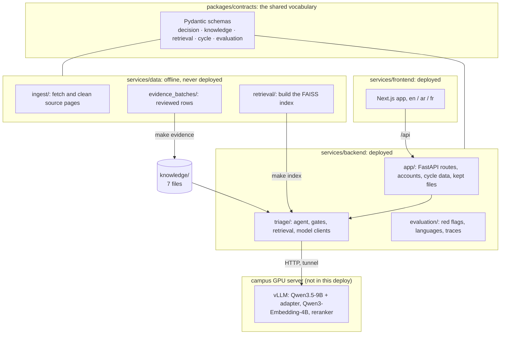
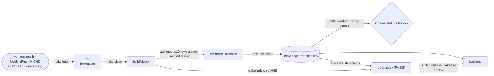

# The repository, explained

**Audience:** a teammate on day one, or a mentor who wants to know where
anything lives. Rewritten 2026-10-20 from the tree as it is. What runs, on
which machines and versions: [`ARCHITECTURE.md`](ARCHITECTURE.md).

---

## The shape in one picture

## Directory by directory

### `knowledge/`: the seven files

`features.yaml` (39), `conditions.yaml` (19), `evidence.csv` (150 rows),
`red_flags.yaml` (17), `sources.yaml` (5), `actions.yaml` (4), `weights.yaml`.
Hand-authored and reviewed; `evidence.csv` is generated from the approved
batches. Detail: [`KNOWLEDGE_BASE.md`](KNOWLEDGE_BASE.md).

### `packages/contracts/`: the shared vocabulary

| Module | Holds |
|---|---|
| `decision.py` | `TriageDecision`, the model's only output shape |
| `knowledge.py`, `loading.py` | the knowledge-file models and loader |
| `retrieval.py` | `RetrievedPassage`, passage types |
| `cycle.py` | `CycleExtraction`, imported cycle data |
| `evaluation.py`, `scoring.py` | benchmark cases and weights |

### `services/backend/`: the running system

| Path | What |
|---|---|
| `app/main.py` | builds the app and the agent (`_build_triage_agent`), start-up, the kept-file clean-up |
| `app/config.py` | every `HERHEALTH_*` setting |
| `app/triage/routes.py` | `POST /triage/turn` and the chat sessions; route checks, sources, storage |
| `app/accounts/` | sign-up and sign-in, sessions, email codes, Google, profile, cycle-data import (`cycle_import.py`), kept files (`stored_files.py`) |
| `triage/agent.py` | `TriageAgent.run_turn`: retrieve, extract, context, decide, gates, pages |
| `triage/chain.py` | the LangChain clients for each model role |
| `triage/clients.py`, `vocabulary.py`, `provenance.py` | parse, repair and check a decision |
| `triage/context.py` | the turn context and "when to get help", from the knowledge files |
| `triage/retrieval.py` | the FAISS retriever and the embedding client |
| `triage/cycle_data.py` | turning imported cycle data into answers and a breakdown |
| `triage/language.py` | reply in her language |
| `triage/engine.py`, `state.py`, `dialogue.py` | the retired rule-based controller (ADR 0011), kept for `make eval` |
| `evaluation/` | `red_flag_eval`, `cross_language_eval`, `decision_eval`, `trace_turns`, benchmark scoring |
| `migrations/` | Alembic, `0001`–`0012` |
| `tests/` | `tests/` without a database, `tests/app/` with one |

### `services/frontend/`: the web app

`src/app/` (pages: sign-up and sign-in, onboarding, dashboard, chat,
settings, how it works, cycle-import guide), `src/components/` (chat,
account, cycle guide, dashboard, layout, ui), `src/i18n/messages/{en,ar,fr}`,
`src/lib/api/` (the API client and types).

### `services/data/`: offline tooling

`ingest/` (robots-checked fetch, cleaning), `evidence.py` and
`evidence_batches/` (27 batches), `retrieval/` (index build), `knowledge.py`
(validation), `eval/` (benchmark, cases, decision scripts in three languages,
trace cases).

### `scripts/`

`serve-models.sh` (start, stop, check the model servers),
`tunnel-models.sh` (tunnels to production, `watch`), `publish-index-release.sh`,
`smoke_models.py`, `check_repo_hygiene.py`.

### `infra/`

`compose.yml` (local PostgreSQL), `compose.prod.yml` (production),
`compose.model.yml` (the model servers under Docker; never run), `caddy/`,
`deploy/` (host scripts: `deploy.sh`, `refresh-secrets.sh`, …),
`model/serve.conf` (model revisions, ports, GPUs), `envs/` (templates;
the real files are git-ignored), `terraform/` (AWS).

### Generated, git-ignored

`raw/` (fetched pages, immutable), `build/` (clean text, the index, traces),
`herhealth-lora-v2/` (the adapter weights), `infra/envs/*.env`.

## Every command

See the README's [Commands](../README.md#commands) table.

## How the data flows, end to end

## Working conventions

- **Python 3.12**, `uv` workspace, committed `uv.lock`.
- **Conventional commits**, scoped: `feat(data):`, `fix(knowledge):`.
- **Never generate more than 10 clinical rows without review.**
- **Ask before any network call.** Tests never hit the network.
- Prefer boring, readable code. This is read by markers.

## Where the docs are

| Document | Answers |
|---|---|
| [`ARCHITECTURE.md`](ARCHITECTURE.md) | What runs, on what, with which versions |
| [`DATASHEET.md`](DATASHEET.md) | What has been measured, and the limits |
| [`KNOWLEDGE_BASE.md`](KNOWLEDGE_BASE.md) | The knowledge files and how they are used |
| [`CODE_GUIDE.md`](CODE_GUIDE.md) | The modules in detail |
| [`ROADMAP.md`](ROADMAP.md) | What is next |
| [`experiments/`](experiments/) | Traced and measured runs |
| [`adr/`](adr/) | Why each significant decision was made |
| [`runbooks/`](runbooks/) | How to run, serve and deploy it |
| [`../CONTEXT.md`](../CONTEXT.md) | The vocabulary |
