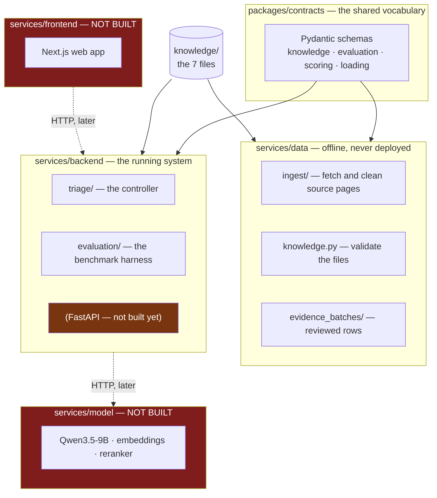
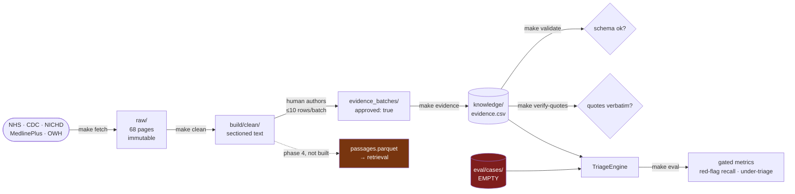

# The repository, explained

**Audience:** a teammate on day one, or a mentor who wants to know where
anything lives. No prior knowledge of the codebase assumed.

---

## The shape in one picture



**The one architectural rule:** nothing outside `packages/contracts` may be
imported across a service boundary. If two services need the same thing, it
moves into contracts. This is why `load_knowledge_base` lives there — the data
service validates the files and the backend reasons over them, so neither may
own it.

---

## Directory by directory

### `knowledge/` — the seven files

The heart of the project. Plain text in git so every clinical change appears as
a reviewable diff. Fully explained in [`KNOWLEDGE_BASE.md`](KNOWLEDGE_BASE.md).

```
knowledge/
├── features.yaml      37 questions the system may ask
├── conditions.yaml    19 conditions it may suspect
├── evidence.csv       135 weighted edges  ← GENERATED, never hand-edit
├── red_flags.yaml     16 escalation rules
├── sources.yaml       5 usable sources
├── weights.yaml       the tunable numbers (all chosen by us)
└── actions.yaml       SELF_CARE · ROUTINE · URGENT · EMERGENCY
```

Counts as of 2026-08-19 — see `CLAUDE.md` for what changed.

> ⚠️ **`evidence.csv` is generated.** Edit `services/data/evidence_batches/*.yaml`
> and run `make evidence`. Hand-edits are silently overwritten and bypass review.

### `packages/contracts/` — the shared vocabulary

The single definition of every data shape. `mypy --strict` runs here and nowhere
else, because these types are what every other service validates against.

| File | Contains |
|---|---|
| `knowledge.py` | Schemas for the seven files; the fixed vocabularies |
| `evaluation.py` | Benchmark case schema — **a variant cannot carry a label** |
| `scoring.py` | Log-odds ↔ plausibility (independent logistic, not softmax) |
| `loading.py` | Strict loader used at runtime |

### `services/data/` — offline tooling

Runs in CI and by hand. **Never deployed.**

```
services/data/
├── src/herhealth_data/
│   ├── ingest/          fetch (robots-checked) → clean → sectioned text
│   ├── knowledge.py     the lenient validator behind `make validate`
│   ├── provenance.py    `make verify-quotes` — 151/151 pass
│   ├── icd.py           WHO ICD-11 lookup, proposes then applies
│   └── cli.py           argument parsing only
├── evidence_batches/    23 approved batches → evidence.csv
└── eval/
    ├── benchmark/       gold_seeds_styled.csv — the source, unedited
    └── cases/           annotated cases  ← EMPTY, this is the bottleneck
```

### `services/backend/` — the running system

```
services/backend/
├── src/herhealth_backend/
│   ├── triage/
│   │   ├── state.py      pure data — Answer, TriageState, Decision
│   │   ├── engine.py     the six stopping rules
│   │   ├── dialogue.py   the consultation loop (pure, no I/O)
│   │   └── cli.py        `herhealth-triage`
│   └── evaluation/
│       ├── metrics.py    which numbers gate a merge
│       ├── runner.py     drives cases through the controller
│       └── cli.py        `herhealth-eval`
├── cases/                4 demonstration consultations, pinned by tests
└── tests/                150 tests
```

No FastAPI yet, and deliberately no dependency beyond contracts: the controller
must run from a test or a CLI with **no server, no GPU and no network**. That is
what makes the evaluation harness possible.

### Not built yet

| Path | What goes there | Needed by |
|---|---|---|
| `services/model/` | Qwen3.5-9B serving, embeddings, reranker | MVP |
| `services/frontend/` | Next.js responsive web app (**not** a PWA) | MVP |
| `packages/types-ts/` | TypeScript generated from the OpenAPI spec | MVP |
| `infra/compose.yml` | Container orchestration, Caddy, Prometheus | Deploy |
| `build/passages.parquet` | The retrieval corpus | RAG |

### Generated, gitignored

```
raw/      68 fetched HTML pages, immutable, hashed   (reproducible: make fetch)
build/    cleaned text, conflicts log, rendered tables
```

Both are reproducible from tracked code, which is why neither is committed.

---

## Every command

```bash
make install        # create .venv from uv.lock — the only setup step
```

### Building the knowledge base

| Command | Does | Network? |
|---|---|---|
| `make fetch-plan` | Show what *would* be fetched | no |
| `make fetch` | Fetch source pages into `raw/` | **yes** |
| `make clean` | Turn HTML into sectioned, quotable text | no |
| `make evidence` | Regenerate `evidence.csv` from approved batches | no |
| `make tables` | Render the knowledge base as CSV + Markdown | no |
| `make icd` | Propose ICD-11 codes via the WHO API | **yes** |

### Checking it

| Command | Checks |
|---|---|
| `make validate` | Schema and cross-file references |
| `make verify-quotes` | Every quote is verbatim in its cited source |
| `make lint` | ruff + mypy strict on contracts |
| `make test` | The full suite — 399 tests |

### Running it

| Command | Does |
|---|---|
| `make triage CASE=...` | One scripted consultation, full trace |
| `make triage-all` | Every demonstration case |
| `make eval` | Benchmark cases through the controller |

Everything runs through `uv run`, which syncs from `uv.lock` first — so you can
never run against a stale environment, and you never activate a virtualenv.

---

## How the data flows, end to end



---

## Working conventions

- **Python 3.12**, `uv` workspace, committed `uv.lock`. CI runs `uv sync --locked`.
- **Conventional commits**, scoped: `feat(data):`, `fix(knowledge):`
- **Stop after each numbered deliverable and wait.**
- **Never generate more than 10 clinical rows without review.**
- **Ask before any network call.** Tests never hit the network.
- Prefer boring, readable code. This is read by markers, not scaled to millions.

## Where the docs are

| Document | Answers |
|---|---|
| [`KNOWLEDGE_BASE.md`](KNOWLEDGE_BASE.md) | How the reasoning works, with diagrams |
| [`REPO_MAP.md`](REPO_MAP.md) | This file — where everything lives |
| [`ROADMAP.md`](ROADMAP.md) | What we are doing now and next |
| [`CODE_GUIDE.md`](CODE_GUIDE.md) | Every module, in detail |
| [`adr/`](adr/) | Why each significant decision was made |
| [`runbooks/`](runbooks/) | Operational procedures — human-run, not code |
| [`../CONTEXT.md`](../CONTEXT.md) | The vocabulary |
