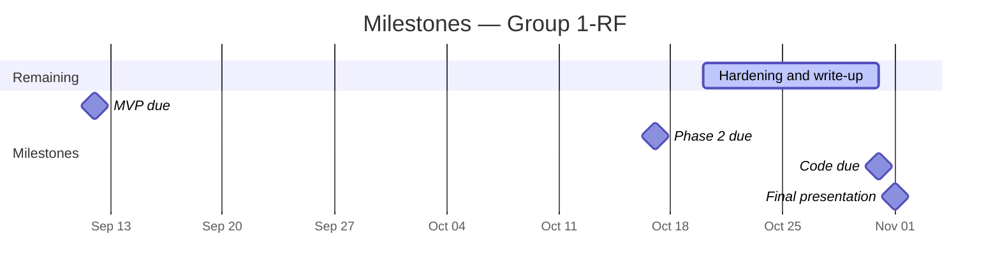

# What we are doing, what is next, and how

**Audience:** the team, the supervisor, and the Deloitte mentors.
**Updated:** 2026-10-20. Update the status table whenever something ships.
What runs: [`ARCHITECTURE.md`](ARCHITECTURE.md). What is measured:
[`DATASHEET.md`](DATASHEET.md).

---

## The dates that govern everything

## Where we are

| Component | Status | Notes |
|---|---|---|
| Knowledge base | ✅ done | 39 features, 19 conditions, 150 evidence rows, 17 warning-sign rules, 5 sources; every quote traced |
| Retrieval | ✅ done | `Qwen3-Embedding-4B` + FAISS, 3,862 passages + 93 evidence statements; needs a rebuild for batch 27 |
| Model serving | ✅ running | vLLM 0.28 on 4 × A16: base, adapter, embeddings, reranker (off) |
| Triage agent | ✅ done | base model decides; six gates; red-flag escalation enforced in code |
| Backend API | ✅ deployed | FastAPI, accounts, sessions, email, Google sign-in |
| Frontend | ✅ deployed | Next.js, English / Arabic / French, right-to-left |
| Cycle data | ✅ deployed | CSV template, Apple Health export and shared PDF, model reading for others; breakdown in chat |
| Kept files | ✅ deployed | 30 days, deleted automatically |
| Production | ✅ live | herhealthgpt.org on AWS; models through tunnels, kept up by a watchdog |
| Evaluation | ✅ tooling done | red-flag recall 17/17, cross-language, traced consultations |
| Adapter retrain (multi-turn) | 🔴 not started | in the training repository; precondition for the adapter deciding anything |
| Native-speaker review (ar, fr) | 🔴 not started | needs a person |

## Remaining work before 31 October

| # | Work | Why | Needs |
|---|---|---|---|
| 1 | Rebuild and republish the index | batch 27's four rows are not retrievable yet | `make index`, `publish-index-release.sh` |
| 2 | Fix Arabic replies with no JSON | Arabic concluded 6 of 10 scripted consultations against 9 in English and French | prompt or parsing work, then `make eval-languages` |
| 3 | A second decline still says "not covered" | vague and medicine questions get a refusal (traced T02, T07) | prompt or gate work |
| 4 | Odd early questions | "dark skin patches" asked early once PCOS is in play (traced T03, T08–T10) | question ranking |
| 5 | Perimenopause matched at 29 | traced T03 | check the age evidence against the named conditions |
| 6 | A lasting tunnel | quick-tunnel addresses change; the watchdog redeploys | a Cloudflare account (named tunnel) |
| 7 | Native-speaker review | Arabic and French wording is unreviewed | a reviewer |

## Known problems we are carrying

All measured, none hidden.

| Problem | Effect | Where measured |
|---|---|---|
| Strict under-triage on first turns: 0.630 | most see-doctor questions got an information page with no urgency level; **none** got a lower level | full benchmark, 2026-10-13 (ADR 0018) |
| Clarification recall 0.189 on vague questions | later improved: 18 of the 22 previously declined now get a question or an answer | 2026-10-13, 2026-10-19 |
| Escalation depends on her answer being read | the code gate escalates only on recorded answers; the extract step can misread | red-flag recall 17/17 in both modes, a measured rate, not a proof |
| The adapter cannot decide | 0 valid decisions on 30 questions as decision-maker | 2026-10-12 |
| Cross-language conclusion rate | Arabic 6/10, English 9/10, French 9/10; where all three concluded, the same urgency 6 of 6 | 2026-10-19 |

The knowledge base is source-traceable, not clinician-adjudicated; the
benchmark's labels are silver. Say so wherever results are shown.

## Deliberately out of scope

- Diagnosis, in any form.
- Medicine advice: a medicine question is always referred to a doctor or
  pharmacist.
- Cancers as named conditions (warning-sign rules send her to care instead).
- The remaining blocked conditions (hyperprolactinaemia, endometrial polyp,
  functional hypothalamic amenorrhoea, pregnancy-related bleeding): no second
  usable source.
- NHS API access (requested; a future improvement, never a dependency).

## What to show at the presentation

1. **A live consultation** on herhealthgpt.org, in English and in Arabic,
   ending with an urgency, its reasons and its sources.
2. **A warning sign** escalating, and the rule's quote shown as the reason.
3. **Cycle data**: the import preview, then the breakdown in chat with its
   source shown.
4. **The trace** of one message through every layer
   ([`experiments/2026-10-19-traced-consultations.md`](experiments/2026-10-19-traced-consultations.md)).
5. **The honest limitations**: the table above and the datasheet.
