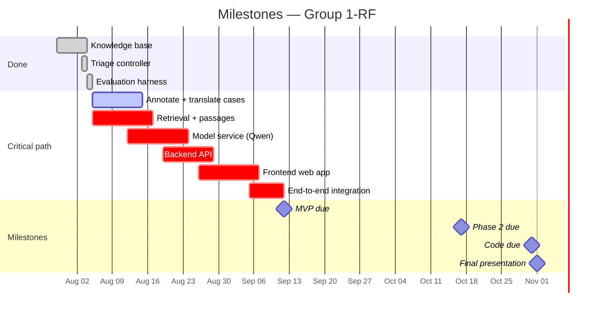
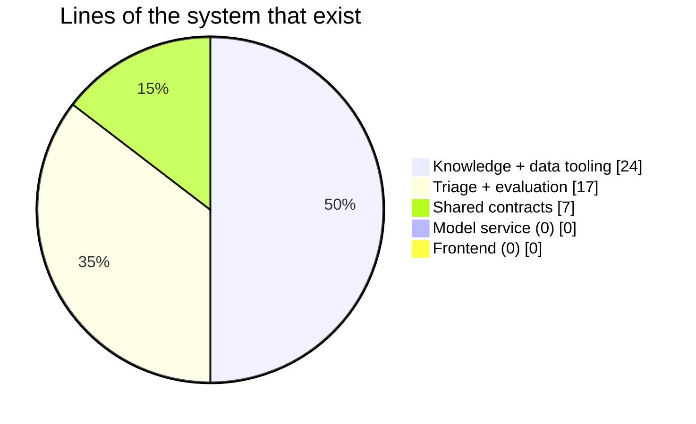
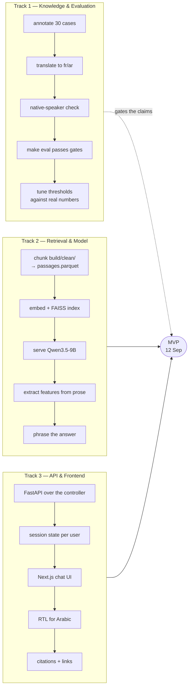
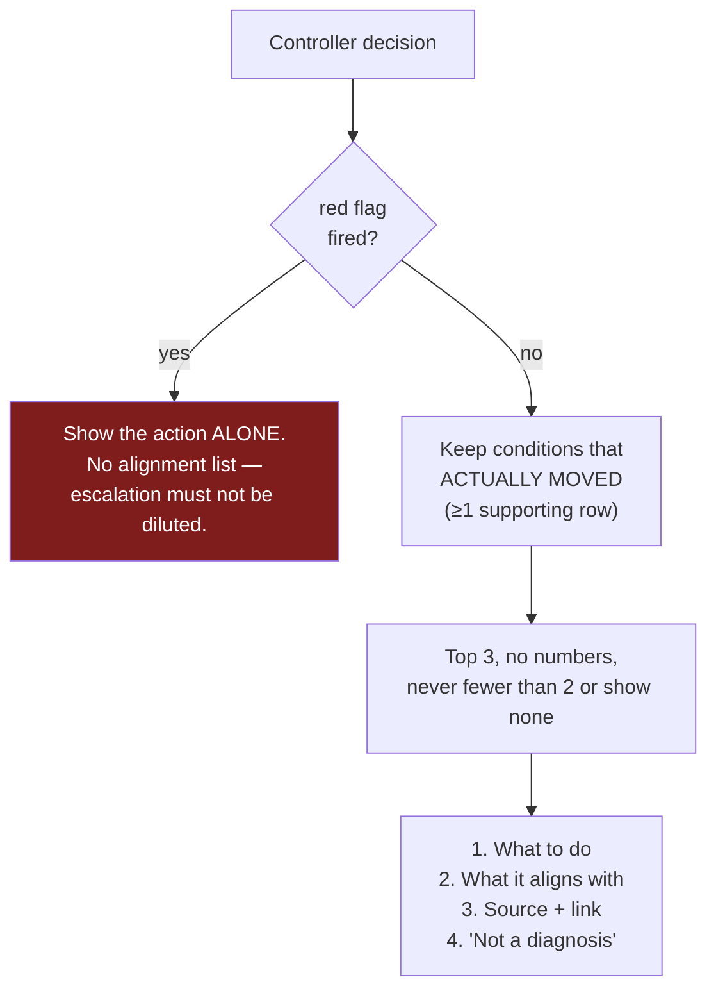

# What we are doing, what is next, and how

**Audience:** the team, the supervisor, and the Deloitte mentors.
**Updated:** 2026-08-04. Update the status table whenever something ships.

---

## The deadline that governs everything

**MVP is due 12 September — five weeks and four days from today.** The MVP *is*
the chatbot. Everything on the critical path above is currently unbuilt.

---

## Where we actually are

| Component | Status | Notes |
|---|---|---|
| Knowledge base | ✅ **done** | 37 features, 19 conditions, 135 rows, 16 red flags (2026-08-19) |
| Provenance checking | ✅ **done** | 151/151 quotes verbatim in source |
| Ingestion pipeline | ✅ **done** | 67 documents fetched and cleaned, robots-checked |
| Triage controller | ✅ **done** | Six stopping rules, 399 tests passing |
| Evaluation harness | ✅ **done** | Metrics + gates written; **no cases to run** |
| Benchmark cases | 🔴 **empty** | The bottleneck — blocks every gated metric |
| Retrieval / RAG | 🔴 **not started** | Cleaned text exists; nothing chunked or embedded |
| Model service | 🔴 **not started** | Qwen3.5-9B not deployed |
| Backend API | 🔴 **not started** | Controller runs from CLI only |
| Frontend | 🔴 **not started** | Nothing exists |

**The honest summary:** the hard, defensible, research-grade part is finished to
a high standard. The visible deliverable does not exist yet. A marker on
1 November needs to *see a working chatbot*, and right now the most impressive
part of this project is invisible without one.

---

## The plan: three tracks, in parallel

Four people, one track each, one shared. Sequential work will not fit.

### Track 1 — Knowledge & Evaluation *(1 person)*

The knowledge base is **frozen for the MVP**. It is already past the quality the
MVP needs and it is not the bottleneck. Remaining work is evaluation only:

1. **Annotate ~30 canonical cases** from `gold_seeds_styled.csv`, in batches of
   10 for review. Each gets feature values, an expected action, a clarification
   flag, and the sentence the label was read from.
2. **Translate those 30 to French and Arabic.** Not the knowledge base — only the
   test questions. See the box below.
3. **Author red-flag cases separately**, from escalation sentences in the fetched
   corpus. The benchmark has almost none (~2 of 90), and red-flag recall is the
   metric that gates merges.
4. **Run `make eval`, then tune.** Findings 1–4 in ADR 0007 all wait on this.

> ### Why the test cases must be translated even though the model is multilingual
>
> Dropping translation from the **knowledge base** is correct — Qwen renders
> probes at response time, and maintaining three copies of 37 probes buys
> nothing.
>
> Dropping it from the **evaluation set** breaks the thesis. The whole problem
> statement is that models degrade in Arabic and French. An English-only test
> set cannot measure per-language under-triage or cross-language action
> agreement — so the central claim goes untested and the baseline comparison
> exists in English only.
>
> This is small: ~30 questions, not 135 evidence rows. NLLB-200 plus a
> native-speaker pass, exactly as the proposal budgeted. The schema already
> carries `Language` on variants and propagates labels from English by
> `canonical_case_id`, so the asymmetry bug cannot recur.

### Track 2 — Retrieval & Model *(1–2 people)*

Start **now**, against the 19 conditions that already exist. Do not wait for the
knowledge base to be perfect — it already is, for this purpose.

1. Chunk `build/clean/` into `build/passages.parquet`. **NHS text must be
   excluded** — it is `citable_only` and may be quoted but never redistributed.
   The validator enforces this; do not work around it.
2. Sentence-BERT embeddings, FAISS index.
3. Serve Qwen3.5-9B behind HTTP. **No model weights load inside the backend
   process** — embeddings and reranking are HTTP calls.
4. Two prompts, and only two: **prose → feature values** on the way in, and
   **decision → sentence** on the way out. The model must never decide urgency.

### Track 3 — API & Frontend *(1–2 people)*

1. FastAPI wrapping `TriageEngine`, one turn per request, session state held
   server-side.
2. Next.js responsive web app. **Not a PWA** — no service worker, no manifest, no
   install prompt.
3. RTL layout for Arabic.
4. Render the answer as: **action → what it aligns with → citations with links**,
   per [ADR 0008](adr/0008-showing-what-symptoms-align-with.md).

---

## What the user will see

Agreed with mentors, specified in [ADR 0008](adr/0008-showing-what-symptoms-align-with.md).

**The line we hold:** diagnosing tells a person what they *have*. This tells a
person what a named source *associates with what they described*. The
grammatical subject is always the source and the symptom, never the user and a
condition.

> **What to do: see a GP within the next few weeks.**
>
> What you described overlaps with what these sources write about:
> - **Uterine fibroids** — NHS lists heavy periods and pelvic pressure among its symptoms. [nhs.uk]
> - **Adenomyosis** — NHS describes heavy, painful periods and fullness in the tummy. [nhs.uk]
>
> This is not a diagnosis, and this list is not complete. Only a clinician can
> tell you which, if any, applies to you.

---

## Deliberately after the MVP

Do not start these before 12 September:

- Suggested articles on women's health
- ~~Cycle-data export/import for context~~ — built 2026-10-18 on
  `feat/cycle-data-import`, [ADR 0019](adr/0019-cycle-data-is-imported-from-any-tracker-and-may-pre-fill-answers.md)
  (proposed). Apple Health and CSV-template converters are not yet checked
  against a real export.
- Fine-tuning (a documented contingency, **not** a deliverable)
- The remaining blocked conditions
- ICD-11 codes beyond what the WHO API already resolved

---

## Known problems we are carrying

All measured, none hidden. Full detail in
[ADR 0007](adr/0007-what-the-first-real-consultations-showed.md).

| # | Problem | Effect | Fix waits on |
|---|---|---|---|
| 1 | Nothing leaves the differential | Was true of all 12 conditions as of the last measured run; **not re-measured** since the 2026-08-19 knowledge base growth to 19 conditions and several new `argues_against` rows (`ovarian_cyst` gained its first). Re-run before citing this row. | More eliminating rows, or a higher floor |
| 2 | Question selection is nearly fixed | Same 6 questions regardless of answers | Making separation depend on current scores |
| 3 | **Every case returns `URGENT_SAME_DAY`** | Safe but uninformative | 1 and 2 above |
| 4 | Stopping rule 4 can under-triage | Latent; pinned by a strict xfail test | A policy decision on over-triage |
| 5 | Two conditions barely modelled | `bacterial_vaginosis` still has 1 row (confirmed 2026-08-19 — genuinely exhausted, not yet backfilled; see `CLAUDE.md`). `thrush` grew from its original count and is no longer the thinnest. | More rows, or drop them |
| 6 | Mid-range answers move nothing | "moderate" is invisible to the controller | ~8 more rows from existing sources |

Problem 3 is the one to explain to mentors: **the system currently tells
everyone to be seen today.** That is the conservative failure, chosen
deliberately — but making it informative without making it unsafe is the real
remaining research problem, and it needs the evaluation set to settle.

---

## What to show at the next mentor check-in

1. **The graph** — [`KNOWLEDGE_BASE.md` §4](KNOWLEDGE_BASE.md#4-the-graph--this-is-the-reason-like-a-doctor-part).
   Questions and conditions as nodes, evidence as typed edges. This is the
   "reason like a doctor" ask, delivered.
2. **A live consultation** — `make triage CASE=services/backend/cases/sudden_severe_pain.yaml`
   prints every question, why it was chosen, what each answer was worth, and
   which rule ended it, citing the NHS sentence.
3. **The provenance guarantee** — `make verify-quotes`, 151/151.
4. **The honest limitations** — the table above. Naming them is the strongest
   thing in the project.
