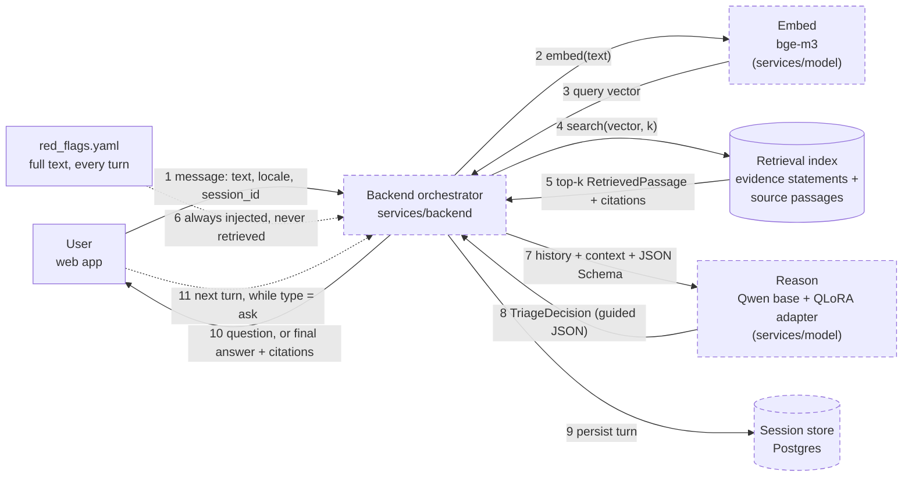
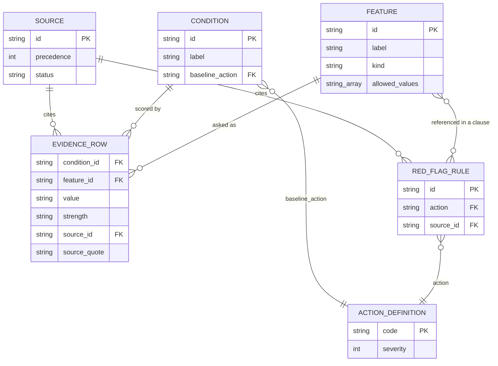
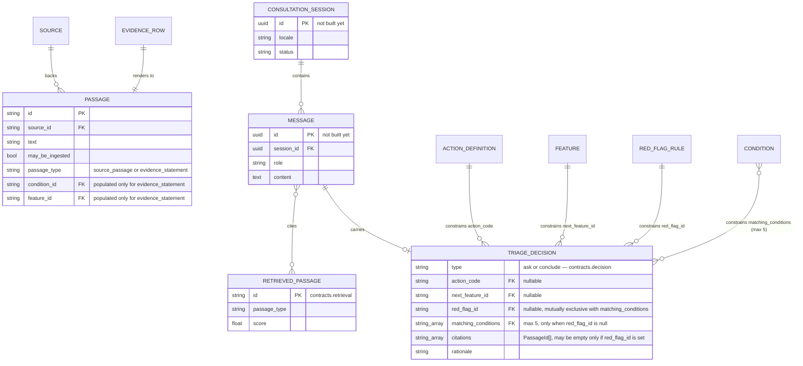

# Remove the deterministic controller for a two-model, retrieval-grounded loop

## Context

Two asks converged with a decision made in-session:

- **The supervisor** wants the fine-tuned model from the team's evaluation
  paper (QLoRA over Qwen, trained on
  `services/data/eval/benchmark/gold_seeds_styled.csv`) actually used in the
  deployed system, retrained if that gets better results, plus the existing
  RAG pipeline.
- **The industry mentors** want a second model dedicated to semantic search
  over the knowledge base, separate from the reasoning/generation model.
- **This ADR's actual decision, made explicitly and against the
  recommendation below**: the deterministic Python stopping controller
  (`herhealth_backend.triage.engine.TriageEngine.should_stop`) is removed.
  The reasoning model decides ask-vs-conclude and the urgency action directly,
  grounded by retrieval, instead of Python.

**This reverses two things on record, not one.** `CLAUDE.md` states as a
binding rule: *"No fine-tuned model decides urgency... A fine-tune may phrase
text; it may never choose an action code"* and *"the triage decision lives in
Python, not in the model or the prompt."* And
[`docs/research/0001-llm-triage-architecture.md`](../research/0001-llm-triage-architecture.md)
— a 1,300-line review of primary literature on exactly this question
(MediQ, HealthBench, EQUITRIAGE, MECR-RAG, FDA CDS guidance, MDCG 2019-11) —
concluded the opposite: *"replace the deterministic controller with an
end-to-end LLM" is contradicted by every primary evaluation found*, while
*"use the paper's fine-tuned model"* and *"add a semantic search model"* were
both supported **without** removing the controller.

`CLAUDE.md` itself says how a change like this is supposed to happen: *"If a
finding here should change the architecture, that change belongs in an ADR
that cites this note."* This is that ADR. It does not soften the research
note's findings to make the decision look safer than it is — the risk
register near the end restates them plainly. **Status is `proposed`, not
`accepted`, because `CLAUDE.md` rules 1 and 2 have not been edited yet and
this has not had supervisor sign-off.** Accepting this ADR means editing
those two lines in the same change.

## Decision

Replace the deterministic `should_stop` controller with a loop in which a
retrieval step (a dedicated embedding model) grounds a reasoning step (the
retrained fine-tune, served alongside its base model) that emits a
schema-validated structured decision every turn. The schema is the only
deterministic safety net left — see [§ Risk register](#risk-register).

This pattern has a name — **agentic RAG** — and it's worth being explicit
about what that name commits to, because the commitment is also the risk.

## What agentic RAG is, and why this looked like a fit

**Plain RAG is one fixed hop.** Embed the query once, retrieve once, stuff
the retrieved text into a single prompt, generate one answer. The model has
no say over the retrieval step — it happens automatically, before the model
ever runs, and happens exactly once per question.

**Agentic RAG puts the model in a loop that controls its own information
gathering.** Instead of one hop, the model decides, turn by turn, whether it
has enough to answer or needs to gather more — and each "needs more" decision
triggers another retrieve-then-reason cycle. Retrieval stops being a fixed
pre-step and becomes something closer to a tool the model chooses to use
again, repeatedly, until it decides to stop. That's precisely what
`TriageAgent.run_consultation` is: every turn calls `run_turn`, which
retrieves fresh context based on whatever was just said, and the model's own
`TriageDecision.type` — `ask` or `conclude` — is the "gather more" / "stop"
choice. A plain-RAG design would retrieve once and answer once; this design
treats each retrieval as one step in an open-ended, model-directed
consultation.

**Why this looked like the right category of solution for this project,
specifically:**

- Triage is inherently multi-turn — gather symptoms, narrow down, conclude —
  which is the shape agentic RAG is built for. Plain RAG assumes one question,
  one answer, and does not fit a consultation at all.
- It's the standard way to combine exactly the two things asked for: a
  dedicated retrieval/embedding model (the mentors' ask) and a reasoning model
  with its own fine-tune (the supervisor's ask), operating together across
  many turns rather than one.
- The mechanism agentic systems use to keep the model's "agency" inspectable
  — constrained, schema-validated structured output instead of free-form
  tool-calling text — is exactly what `TriageDecision` plus vLLM guided
  decoding already provides. Adopting the pattern didn't require inventing new
  infrastructure.
- It reuses retrieval code that already existed in this repo
  (`PassageIndex`, `embed.py`) rather than discarding it — promoting it from
  an authoring-only tool to something queried every turn, not replacing it.

**What adopting it inherits, and this is not a new risk on top of the
existing one — it is the same risk, more precisely named.** Agentic RAG's
best-documented failure mode is a model that decides, on its own, that it has
"enough" and stops early, or never asks at all. That is exactly what
[MediQ](https://arxiv.org/abs/2406.00922) found (naive prompting to ask
degrades accuracy ~11%) and exactly what this project's own benchmark showed
(under-triage collapsing to 0.994). The fix MediQ needed — an *external*
abstention/stopping module bolted onto the loop, not the model's free
judgement — is structurally what `should_stop` used to be, and structurally
what this ADR removes. Calling this "agentic RAG" doesn't add a risk; it
gives the risk already in the [risk register](#risk-register) its standard
industry name, which is worth knowing for the write-up.

## What's new, what's kept, what's gone

**New components:**

- **`services/model/`** — does not exist on disk yet. A real vLLM deployment
  serving two model identities over HTTP: `BAAI/bge-m3` for embeddings (ADR
  0010, unchanged choice) and the base reasoning model with the QLoRA adapter
  registered via `--enable-lora --lora-modules`, selected per request by the
  `model` field.
- **`TriageDecision`** (`packages/contracts/src/herhealth_contracts/decision.py`,
  **built this session**) — the structured JSON the reasoning model must emit
  each turn: `type` (`ask` \| `conclude`), and depending on which,
  `next_feature_id` + `question_text`, or `action_code` plus, when not driven
  by a red flag, up to five `matching_conditions` — the product decision to
  name which authored conditions the pattern matches, not just an urgency
  level (capped at 5 by the schema itself: an early run against the real
  knowledge base named 18 of 18 conditions on almost every conclusion, since
  most conditions here have no eliminating evidence row — see the worked
  example below). Every decision also carries `rationale` and at least one of
  `citations` (real `RetrievedPassage` ids) or `red_flag_id` (a real
  `red_flags.yaml` id — added after tracing the worked example below showed a
  red-flag-grounded decision had nothing else to cite). `matching_conditions`
  and `red_flag_id` are mutually exclusive, enforced in the schema: a
  red-flag-driven decision must never name a condition, generalising
  `CLAUDE.md`'s existing cancer-omission rule to every red flag. Its
  `model_json_schema()` is passed to vLLM as the guided-decoding contract, so
  the model cannot emit a `feature_id`, `action_code`, or `condition_id`
  outside its closed vocabulary — this is the one thing that still cannot go
  wrong the way free generation could.
- **`RetrievedPassage`** (`packages/contracts/src/herhealth_contracts/retrieval.py`,
  **built this session**) — the cross-service shape of one search hit, so the
  backend can hold retrieval results without importing `services/data`
  (which the import-linter rule forbids once retrieval leaves the authoring
  path and enters the serving path).
- **Evidence statements** (`evidence_statement_passages`,
  `services/data/src/herhealth_data/retrieval/passages.py`, **built this
  session**) — every `evidence.csv` row rendered as a retrievable sentence
  and embedded into the same index as ordinary source passages.
- **`TriageAgent`** (`services/backend/src/herhealth_backend/triage/agent.py`,
  **built this session**) — the orchestration loop itself: `ReasoningClient`
  and `RetrievalClient` protocols, `TriageAgent.run_consultation`, and
  `MaxTurnsExceeded` for the hard turn cap. Built **next to** `engine.py`,
  not in place of it yet — nothing is deleted until this is reviewed. A
  `ScriptedReasoningClient` test double (no model, no network) is included,
  mirroring `HashingEmbedder`'s role.
- **Bootstrap retraining data** (`services/backend/src/herhealth_backend/triage/bootstrap_dataset.py`,
  **built and run this session**) — see below. Produced 18 multi-turn
  conversations (one per condition currently in `knowledge/conditions.yaml` —
  more than the 12 this ADR's citations reference; the knowledge base has
  grown since `docs/research/0001` was written) at
  `services/data/eval/benchmark/bootstrap_multi_turn.jsonl`.
- **Session/turn persistence** — `consultation_session`, `message` tables
  (new alembic migration). **Not started.**
- **The actual retraining run** — the adapter has not been retrained; only
  the bootstrap data it needs exists so far. **Not started.**

**Kept, unchanged:**

- The seven knowledge files, authored and reviewed exactly as before
  (`evidence_batches/*.yaml` → `make evidence` → `evidence.csv`).
- `ActionCode`, `EvidenceStrength`, `allowed_values` — the closed vocabularies
  now double as the guided-decoding contract instead of a scoring input.
- Source licensing (`Source.may_be_ingested`, NHS `citable_only`) — enforced
  identically for evidence-statement passages as for source passages.
- `bge-m3` as the embedding model (ADR 0010) and sentence-level chunking.

**Gone (not yet deleted — see [§ Migration checklist](#migration-checklist)):**

- `TriageEngine.should_stop`, `TriageState`, `Decision`, `StopReason`
  (`services/backend/src/herhealth_backend/triage/engine.py`, `state.py`).
- `packages/contracts/src/herhealth_contracts/scoring.py` as a serving-path
  dependency (`log_odds_for`, `plausibility`) — no consumer left once
  `should_stop` is deleted. Worth keeping for an eval-only baseline
  comparison; see [§ Migration checklist](#migration-checklist).
- Code-evaluated red-flag clauses (`_clause_matches`,
  `_first_matching_red_flag`) — replaced by injecting `red_flags.yaml`
  verbatim into every reasoning-model call (see the flow diagram). This is
  the single largest capability the deterministic version had that this
  design does not: a rule that used to be a guaranteed 100%-recall code path
  is now a pattern the model has to notice.

## Did `evidence.csv` need to be renamed?

**No, and it wasn't.** It keeps its name and its authoring path, because the
review gate that makes every row source-traceable does not depend on who
reads the CSV afterward. What changed is the *consumer*: today its only
reader is `TriageEngine`, which sums `strength` into a log-odds score. Once
that reader is gone, a bare `(condition_id, feature_id, value, strength)`
tuple means nothing to a language model unless it is told what it means — so
each row is now *also* rendered into a full sentence and embedded, tagged
`passage_type="evidence_statement"` so a citation can still be traced back to
its structured row. No new file. `Passage`
(`services/data/src/herhealth_data/retrieval/passages.py`) grew four optional
fields; `passages.parquet`'s schema grows the same four columns the next time
`make index` runs.

## Do the knowledge YAML files need to become JSON?

**No.** YAML/CSV stays the authoring format — [ADR
0002](0002-yaml-for-nested-files-csv-for-the-evidence-grid.md)'s reasoning
(diffable, human-reviewable) is unchanged by this pivot; nothing about
removing the controller touches how a row gets *written*. Two places
genuinely need JSON, and neither is a knowledge file:

1. **The passage index's serving format is already JSON.** `PassageIndex`
   persists as `passages.jsonl` today (`services/data/src/herhealth_data/retrieval/index.py`)
   — this already exists, nothing to add.
2. **`TriageDecision.model_json_schema()`** — a JSON Schema generated from the
   Pydantic contract above, passed to vLLM's guided-decoding parameter. This
   is new, and it is the actual answer to "what needs to be JSON": not the
   knowledge base, the model's *output contract*.

The per-request payload built for the reasoning model (conversation history +
retrieved passages + red flags) is also JSON, but it is assembled in memory
per turn — it is not a repo file and does not need to be one.

## The flow, end to end



Dashed-border boxes are **not wired to a live server yet** —
`services/model` does not exist on disk, `TriageAgent` (`Backend`'s loop) has
no real `ReasoningClient`/`RetrievalClient` behind it, and there is no
session store. Solid boxes (`Index`, `RedFlags`) reflect what's actually on
disk and working today: the retrieval index already builds from `make index`
and already includes evidence statements, and `render_red_flags()` already
produces the injected block, both as of this session's changes. `features.yaml`
and `conditions.yaml` reach the model only indirectly — see the exact-flow
section below, which corrects the impression this diagram would otherwise give.

### Exactly which file the model sees, when, and how

The seven knowledge files are never hand​ed to the model directly — they act
at build time, then at request time only through their effects. Two
different timelines, not to be conflated:

**Build time (`make index`), once, offline:**

- `sources.yaml` licenses everything: `Source.may_be_ingested` decides
  whether a source's text may ever enter the served passage corpus.
- `features.yaml` and `conditions.yaml` define the closed vocabularies that
  `evidence.csv` rows must reference (`condition_id`, `feature_id` must
  exist in both) — referential integrity, checked by `make validate`.
- `evidence.csv` is rendered into retrievable sentences by
  `evidence_statement_passages()` and embedded into the same index as
  ordinary source-document sentences (`load_passages`).
- `actions.yaml` and `features.yaml` become the enums inside
  `TriageDecision.model_json_schema()` — the closed vocabulary the guided
  decoder is allowed to emit from.

**Request time, `TriageAgent.run_turn`, every turn:**

1. `history[-1].content` (the user's latest message, not a knowledge file)
   becomes the retrieval query.
2. **Embed** — `bge-m3` turns the query into a vector. No knowledge file is
   touched here.
3. **Search the index** — built only from cleaned source sentences and
   evidence-statement sentences (step above). **`features.yaml` and
   `conditions.yaml` are not independently searchable today** — their
   content only reaches the model *through* the evidence-statement text
   (a feature's and condition's `label` are baked into the rendered
   sentence), not as their own retrieval target. `docs/research/0001`
   named this gap directly (mapping open-ended prose onto the closed
   feature vocabulary); it is still open, and is not the same gap as "add a
   semantic search model" — that part is done.
4. **`red_flags.yaml`, in parallel, unconditionally** — `render_red_flags()`
   renders all 14 rules verbatim into the system prompt on *every* call,
   regardless of what step 3 retrieved. The one file that deliberately
   bypasses retrieval.
5. The reasoning model receives one call: system prompt + red-flag block +
   full history + retrieved passages (each carrying a `citation` traced
   through `Passage` → `source_id` → `sources.yaml`).
6. It replies as `TriageDecision`, constrained by the enums built from
   `features.yaml` and `actions.yaml` at build time (step above) — this is
   the second and only other way those two files act on a live turn.
7. Backend re-validates, persists, and loops to 1 or returns.

`weights.yaml` participates in none of this except `max_questions`, carried
forward as `TriageAgent.max_turns` — a turn-count cap, not a threshold
anything is compared against anymore.

**An implementation detail to get right in migration step 4, flagged now
rather than discovered later:** `PassageIndex.search()` does not filter by
`may_be_ingested` automatically — it is an opt-in `where` clause. Whatever
concretely implements `RetrievalClient` must pass
`where=lambda p: p.may_be_ingested` on every serving-time search, or NHS's
`citable_only` text (37 of 89 evidence rows) leaks into a live, redistributed
answer. Nothing enforces this yet because `RetrievalClient` is still only a
`Protocol`.

**Injecting `red_flags.yaml` in full, rather than retrieving it, is the single step that most changes the safety profile** (step 6 in the diagram above, step 4 in the numbered list above). Retrieval is
approximate — nothing guarantees a red flag's text is in the top-*k* hits for
a given query — so red flags are not retrieved at all. All 14 rules from
`red_flags.yaml` are injected into every reasoning-model call, in full, every
turn. That keeps the *chance* of the model noticing a red flag as high as
this design can make it, but it is no longer a guarantee, which is the
subject of the risk register below.

## The system prompt

`agent.DEFAULT_SYSTEM_PROMPT` (`services/backend/src/herhealth_backend/triage/agent.py`,
also used by `bootstrap_dataset.py` so the bootstrap data and the served
prompt can never drift apart):

> You are an AI triage assistant for reproductive-health questions, not a
> clinician, and you must never diagnose — never tell her she "has" a
> condition. When you conclude for a reason OTHER than a red-flag rule, you
> may name up to a few (no more than five, and usually fewer) of the
> authored conditions her answers most closely match, always phrased as a
> possibility grounded in evidence, never as a conclusion about what is wrong
> with her — for example: "Based on your answers, this may match patterns
> our sources associate with PCOS or perimenopause." Name only a handful of
> the closest matches — a long list of everything not yet ruled out is not
> useful guidance. Never name a specific disease when a red-flag warning sign
> is the reason for concluding — red flags exist to escalate on a symptom
> pattern without asserting what it is. Every citation, whether for a matched
> condition or an urgency level, is tied to a cited source. Ask one
> clarifying question at a time, or give urgency guidance — exactly one of
> SELF_CARE, ROUTINE_APPOINTMENT, URGENT_SAME_DAY, or EMERGENCY. Remind her
> plainly, in your own words, that you are an AI tool, not a clinician, and
> that this is based on her answers and the cited evidence, not a diagnosis.
> End every reply, question or final answer alike, with: "Urgency guidance
> only, from cited sources. Not a diagnosis." Under-triage is the dominant
> failure mode: when in doubt, prefer sending her to care sooner rather than
> later.

What each clause is doing, and which rule it enforces:

| Clause | Enforces |
|---|---|
| "not a clinician... must never diagnose... never tell her she 'has' a condition" | `CLAUDE.md`'s binding rule: *"It never diagnoses."* No file, string, or UI copy may frame this system as diagnosing — the prompt is where that rule reaches the model. |
| "you may name up to a few... of the authored conditions her answers most closely match" | The behaviour explicitly requested: don't stop at an urgency level, name what matched — mirrors `TriageDecision.matching_conditions`. |
| "no more than five, and usually fewer... a long list... is not useful guidance" | The cap discovered by actually generating bootstrap data against the real knowledge base: because most of the 18 authored conditions have no eliminating evidence row (ADR 0007 finding 1), an unbounded "everything still plausible" list came out as 18 or 19 conditions — the entire roster, not a differential. Mirrors `TriageDecision.matching_conditions`'s hard `max_length=5`. |
| "Never name a specific disease when a red-flag warning sign is the reason for concluding" | The cancer omission specifically: `CLAUDE.md` states cancer is deliberately unmodelled and *"served by red flags instead — postmenopausal bleeding routes to a GP without ever naming why."* This clause generalises that to every red flag, not only the cancer-motivated ones, and mirrors `matching_conditions` and `red_flag_id` being mutually exclusive in the schema. |
| "Every citation... is tied to a cited source" | Informational grounding stays *associative* ("matches patterns") rather than diagnostic ("you have"), and never ungrounded — the prose-level mirror of `TriageDecision` requiring `citations` or `red_flag_id`. |
| "exactly one of SELF_CARE, ROUTINE_APPOINTMENT, URGENT_SAME_DAY, or EMERGENCY" | Restates the closed action-code vocabulary in words, on top of the schema enforcing it structurally — belt and braces, not a substitute for the schema. |
| "Remind her plainly... you are an AI tool, not a clinician" | Stated explicitly, not left implicit in the disclaimer sentence alone — the specific framing requested for this feature. |
| Closing disclaimer sentence | Verbatim match to `herhealth_backend.triage.cli.DISCLAIMER`, already printed on every scripted-consultation run today. Kept byte-identical on purpose — three near-identical disclaimers drifting apart over time is worse than one shared string. |
| "Under-triage is the dominant failure mode..." | Restates `CLAUDE.md`'s tie-break rule in the one place a probabilistic component can actually act on it: the prompt. |

This prompt is a request, not a guarantee — nothing about it is checked by
code the way `TriageDecision`'s shape is. Whether the model actually follows
"matches patterns, never diagnoses" under real conversational pressure is an
evaluation question, not a prompt-engineering one, and belongs in the same
retraining/evaluation work as the rest of this ADR.

## A worked example, start to finish

Traced with real data from `knowledge/` — nothing below is invented. This is
also the answer to "what does 'search `features.yaml`' even mean" from the
discussion that produced this ADR: there are **two different kinds of
search** at play, and conflating them is what made the earlier explanation
unclear.

- **Search A — evidence & fact retrieval (built).** Searches the index built
  from `evidence.csv`-derived sentences and cleaned source-document sentences.
  Answers: *"what do our trusted sources say about the symptoms she just
  described?"*
- **Search B — feature/vocabulary mapping (not built).** Would search
  `features.yaml`'s labels and probes directly. Answers a different question:
  *"which of our ~37 known symptom names does this sentence refer to?"* For
  example, matching "bleeding through a pad every hour" to the feature
  `bleeding_heaviness` at the value `soaking_hourly`. This is the
  concept-normalisation gap `docs/research/0001` named and this session did
  not build. Note carefully what Search B would and would not do even if
  built: it would identify *which feature* she's talking about; it would not,
  by itself, extract *which value* she gave — that remains something the
  reasoning model has to do, whether or not Search B exists.

**The scenario.** A user opens with:

> "I've had really bad pain in my lower belly since yesterday, and I feel
> sick to my stomach. I don't think I have a fever."

Nothing in this design extracts that into `pelvic_pain_severity=severe,
feeling_sick_or_vomiting=yes, fever=no` anywhere in code — there is no
`TriageState`-equivalent accumulator anymore. The reasoning model has to
work that out itself, silently, from the raw sentence, every time it reads
the transcript. That's a real reduction in structure compared to the old
design, stated here rather than left implicit.

**Turn 1.**

1. Query = the message above, verbatim.
2. `bge-m3` embeds it.
3. The index returns real hits, e.g.:

   | score | passage id | text | citation |
   |---|---|---|---|
   | 0.81 | `0c7cd11965318cad` | "Severity of pelvic pain = severe (strong support) for Adenomyosis. Source: \"painful periods — the pain may be severe and stop you from doing your usual activities\"" | `nhs/evidence/adenomyosis/pelvic_pain_severity/severe` |
   | 0.77 | `ca6e6463ceb0845f` | "Nausea or vomiting = yes (weak support) for Ovarian cyst. Source: \"If a cyst causes twisting of an ovary, you may have pain along with nausea and vomiting.\"" | `womenshealth/evidence/ovarian_cyst/feeling_sick_or_vomiting/yes` |

   (Real `evidence_statement_passages()` output for real evidence.csv rows;
   the similarity scores are illustrative — no embedding model actually ran.)
4. `red_flags.yaml`, in full, is injected regardless of what step 3 found.
   Four of its 14 rules are live given only what she's said so far:
   `severe_pelvic_pain` (URGENT_SAME_DAY, needs only severity),
   `pelvic_pain_with_nausea_or_vomiting` (URGENT_SAME_DAY, severity + nausea),
   `pelvic_pain_with_fever` (URGENT_SAME_DAY, not satisfied — she says no
   fever), and **`sudden_severe_pelvic_pain` (EMERGENCY, needs severity +
   `pain_onset=sudden`) — one unasked fact away.** This is exactly the old
   engine's escalation-screen situation (ADR 0007): a more severe rule sits
   one answer away from two already-live URGENT_SAME_DAY rules. The old
   controller *forced* asking about onset before concluding, by code. Nothing
   forces it here — the model has to notice this itself, from the red-flag
   text it was just handed.
5. The correct `TriageDecision` — assuming the model does notice —
   grounded in both a retrieved passage and the almost-fired red flag:

   ```json
   {
     "type": "ask",
     "next_feature_id": "pain_onset",
     "question_text": "Did the pain come on gradually, or suddenly?",
     "action_code": null,
     "citations": ["5dcce4e37a8f2821"],
     "red_flag_id": "sudden_severe_pelvic_pain",
     "rationale": "What you've described already matches patterns associated with needing same-day care. I'm asking whether the pain started suddenly because national guidance treats that combination as more urgent still, so I want to check before giving you an answer."
   }
   ```

   `5dcce4e37a8f2821` is the real passage id for
   `ovarian_cyst / pain_onset=sudden / strong_support`, quoting "If a cyst
   ruptures, it can cause sudden, severe pain." (womenshealth). Tracing this
   exact turn is what surfaced that `TriageDecision` originally had no way to
   cite a red flag at all — `citations` alone, required non-empty, could not
   represent a decision grounded in `red_flags.yaml` text, since red flags are
   never embedded or retrieved. `red_flag_id` was added to `TriageDecision`
   this session specifically because this example could not otherwise be
   expressed as valid JSON.

**Turn 2.** User replies: *"It came on pretty suddenly, within about an
hour."* History is now three messages. Query = that reply. Retrieval likely
surfaces the same `5dcce4e37a8f2821` passage again. `severity=severe` +
`pain_onset=sudden` now satisfies `sudden_severe_pelvic_pain` outright:

```json
{
  "type": "conclude",
  "next_feature_id": null,
  "question_text": null,
  "action_code": "EMERGENCY",
  "citations": ["5dcce4e37a8f2821"],
  "red_flag_id": "sudden_severe_pelvic_pain",
  "rationale": "Severe pain that came on suddenly matches a specific emergency warning sign in national guidance, so this needs care right away rather than waiting."
}
```

Phrased for the user, under the system prompt above: *"Based on what you've
told me, this needs emergency care right away. What you've described — pain
that came on suddenly and severely — matches a specific warning sign in
national health guidance. Urgency guidance only, from cited sources. Not a
diagnosis."* No condition is named anywhere in that sentence, even though
`sudden_severe_pelvic_pain`'s own source page (NHS's PID page) is
about a named condition — exactly the discipline `CLAUDE.md` already applies
to cancer, generalised by the system prompt above to every red flag.

**A third branch — the non-red-flag path, where naming conditions is
allowed.** Real bootstrap output (`bootstrap_multi_turn.jsonl`) for a
different persona, whose answers never fired a red flag:

```json
{
  "type": "conclude",
  "action_code": "ROUTINE_APPOINTMENT",
  "matching_conditions": ["uterine_fibroids", "urinary_tract_infection", "adenomyosis", "inherited_bleeding_disorder", "bladder_pain"],
  "citations": ["<passage id for the strongest-matching row>"],
  "rationale": "Nothing above is urgent, but several patterns in the sources match what she described closely enough to name."
}
```

phrased to the user as: *"Based on what you've told me, arrange a
non-urgent appointment with a healthcare professional. What you've described
matches patterns our sources associate with uterine fibroids, a urinary
tract infection, adenomyosis, an inherited bleeding disorder, and bladder
pain syndrome. For example: '...' I'm an AI tool, not a clinician — this is
based on your answers and cited sources, not a diagnosis. Urgency guidance
only, from cited sources. Not a diagnosis."*

That five-item list is the capped version. **The first, uncapped run of this
exact script named all 18 authored conditions on almost every conclusion** —
because most conditions here have no `argues_against` row (ADR 0007 finding
1), so the "live differential" barely narrows regardless of what she
answered. A list that long is not a differential, it's the condition roster,
and it would have shipped looking like a real feature while actually
providing no signal. `TriageDecision.matching_conditions`'s
`max_length=5` and the equivalent instruction in the system prompt exist
specifically because this was caught by running the real pipeline against
real data, not found by inspection.

## Schema, entity by entity

The previous version of this diagram put every entity in one picture and
drew them all as equal-looking boxes. That was the wrong call — it makes
"these are all tables in one database" the implicit claim, and that claim is
false. The entities below live in three genuinely different places, and
mixing them without saying so is what made the diagram confusing. Read this
table before either diagram:

| Group | Entities | Where it actually lives |
|---|---|---|
| **The knowledge base** — real files, on disk, in this repo today, unchanged by this ADR | `SOURCE`, `CONDITION`, `FEATURE`, `EVIDENCE_ROW`, `RED_FLAG_RULE`, `ACTION_DEFINITION` | `knowledge/*.yaml` and `knowledge/evidence.csv`, loaded into the `herhealth_contracts.knowledge` Pydantic models. Open the file, see the row. |
| **Generated or in-memory shapes** — new or extended this session, never hand-authored, not under `knowledge/` | `PASSAGE`, `RETRIEVED_PASSAGE`, `TRIAGE_DECISION` | `PASSAGE` is a build artifact: code (`evidence_statement_passages`, `load_passages`) writes it to `passages.jsonl` under a `build/` directory when `make index` runs — nothing to open in `knowledge/`. `RETRIEVED_PASSAGE` and `TRIAGE_DECISION` are Pydantic schemas in `packages/contracts`; both are constructed fresh in memory on every request and, today, stored nowhere — there is no database row for either yet. |
| **Proposed, not built** | `CONSULTATION_SESSION`, `MESSAGE` | Nothing. No code, no migration, no table. These are what the *next* piece of work needs to create — shown here so the rest of the diagram has somewhere to point. |

`weights.yaml` — the seventh knowledge file — is not in either diagram. It is
a single record of tuning constants, not a table of rows, so it does not fit
an entity-relationship shape; see "What's new, what's kept, what's gone"
above for what happens to it.

**Diagram 1 — the knowledge base, exactly as it exists today.** Nothing here
changed this session. This is `herhealth_contracts.knowledge`, drawn as an
ERD for the first time, not a new schema.



**Diagram 2 — what's new or proposed, and how it points back at diagram 1.**
`SOURCE`, `EVIDENCE_ROW`, `FEATURE`, `CONDITION`, `ACTION_DEFINITION` and
`RED_FLAG_RULE` reappear here **without their attribute lists** — they are
the same six entities from diagram 1, repeated only as anchors so the new
arrows have somewhere real to point. Nothing about them changed; look at
diagram 1 for their fields.



Two relationships worth naming explicitly because the diagram can only imply
them, both validation rules inside `herhealth_contracts.decision.TriageDecision`
rather than something an ERD's `||` and `o{` marks can express:

- `TRIAGE_DECISION` requires **`citations` OR `red_flag_id`**, not
  necessarily both. See "A worked example" above for a decision using
  `red_flag_id` with empty `citations`.
- `matching_conditions` and `red_flag_id` are **mutually exclusive** — a
  decision naming a condition may not also be red-flag-driven, and vice
  versa. The arrows say *what a field is allowed to reference*; they don't
  say *which fields may be populated together*.

## Schema deltas, file by file

| File | Change | Status |
|---|---|---|
| `packages/contracts/src/herhealth_contracts/retrieval.py` | **New.** `PassageId`, `PassageType` (`source_passage` \| `evidence_statement`), `RetrievedPassage`. | Done |
| `packages/contracts/src/herhealth_contracts/decision.py` | **New.** `DecisionType`, `TriageDecision` — the guided-decoding contract. | Done |
| `packages/contracts/src/herhealth_contracts/__init__.py` | Exports the four names above. | Done |
| `services/data/src/herhealth_data/retrieval/passages.py` | `Passage` gains `passage_type`, `condition_id`, `feature_id`, `value`, `strength`. New `evidence_statement_passages()`. | Done |
| `services/data/src/herhealth_data/retrieval/__init__.py` | Exports `evidence_statement_passages`. | Done |
| `services/data/src/herhealth_data/commands.py` (`run_index`) | `make index` now embeds evidence statements alongside source passages. | Done |
| `knowledge/evidence.csv` | Unchanged file; role changes (see above). | No file change |
| `services/backend/src/herhealth_backend/triage/bootstrap_dataset.py` | **New.** Runs the outgoing `TriageEngine` over one synthetic persona per condition and exports multi-turn conversational JSONL for retraining. Run once already — see output path below. | Done |
| `services/backend/src/herhealth_backend/triage/agent.py` | **New.** `TriageAgent`, `ReasoningClient`/`RetrievalClient` protocols, `Message`, `AgentTurn`/`AgentTranscript`, `MaxTurnsExceeded`, `ScriptedReasoningClient`. The orchestration loop, built alongside `engine.py` rather than replacing it yet. | Done |
| `services/data/eval/benchmark/bootstrap_multi_turn.jsonl` | **New, generated.** 18 conversations, one per authored condition. Bootstrap-quality only — every "user" turn is templated from `evidence.csv`, not real prose. | Done |
| `services/backend/src/herhealth_backend/triage/engine.py`, `state.py`, `dialogue.py` | Deterministic controller — untouched. Deleted only after `TriageAgent` is wired to a real `services/model` and reviewed. | Not started (deliberately) |
| `services/model/` | vLLM deployment — bge-m3 + base model + QLoRA adapter. | Not started |
| Session/turn persistence + alembic migration | `consultation_session`, `message` tables. | Not started |
| Retraining run itself | Fine-tuning the adapter on the bootstrap data (plus more than bootstrap data alone — see the retraining section). | Not started |

## The fine-tuned model's new job, and why it has to be retrained

`CLAUDE.md` and `docs/research/0001` both describe today's adapter — QLoRA
over Qwen, trained on `gold_seeds_styled.csv` (540 rows, 90 seeds × 6
registers) — as safe to use only for *phrasing*, because every single row in
that file is a complete answer and not one is a clarifying question. That is
the documented, measured cause of the model's clarification rate collapsing
from 0.856 to 0.000 when it was allowed to decide anything: it was shown
5,400... no — 540 examples where an assistant turn *is* a finished answer,
and it learned exactly that.

The supervisor's instruction — use the fine-tune, retrain it if that gets
better results — is compatible with this design, **but only if the retrain
happens before the adapter is trusted to decide.** Handing the *current*
adapter the ask/conclude decision without retraining it would very likely
reproduce the same collapse this project already measured, just with
retrieval bolted on rather than fixed.

What the retrain needs, concretely:

- **Conversational format, not single-turn QA.** TRL's `SFTTrainer` accepts a
  `{"messages": [...]}` shape with `assistant_only_loss=True`, so loss only
  touches assistant turns.
- **Real examples where the correct assistant turn is a clarifying
  question.** None exist in `gold_seeds_styled.csv` today.
- **A source for those examples that does not require a clinician.** The
  outgoing `TriageEngine` (`services/backend/src/herhealth_backend/triage/dialogue.py`,
  `run_consultation`) already produces exactly this shape — a `Transcript` of
  `(state, decision, answer)` turns, deterministic and already traced through
  `evidence.csv`. Running it one last time over the cases in
  `services/data/eval/cases/` before it is deleted, and converting each
  `Turn` into a `(conversation-so-far → next question)` or
  `(conversation-so-far → conclude with action + citations)` training pair,
  is the cheapest way to bootstrap multi-turn data without a clinician
  reviewer — the same "model proposes, a rule-based process disposes"
  discipline already used for evidence authoring (`propose.py`).
- **Still a LoRA adapter, served via vLLM `--enable-lora` / `--lora-modules`,
  selected per request by the `model` field.** The serving mechanism does not
  change — only what the adapter is trained to do with a turn.

## What CI and evaluation must change

`CLAUDE.md`'s evaluation section currently states: *"Blocks merge: red-flag
recall (must be 100%)."* That gate was checkable **because** red flags were
evaluated by code against every combination of clauses — a proof, not a
sample. Once escalation depends on the model noticing injected text, 100%
recall stops being provable pre-deployment and becomes a rate measured on a
benchmark, like every other metric. `make eval` needs to change from
asserting `== 1.0` to reporting the number, and `DATASHEET.md` needs a
sentence saying escalation is now a learned behaviour, not a proven
invariant — the same honesty this project already applies to "not
clinician-adjudicated."

## Risk register

Restated from `docs/research/0001`, not softened:

- **Models under-ask.** MediQ found prompting LLMs to ask questions
  *degrades* accuracy (~11% relative); recovering it needed an *external*
  abstention module and still closed only 51.2% of the gap. This design
  removes that external module.
- **This project's own measurement is the sharpest data point available.**
  Under-triage rose from 0.718 to 0.994 in French when a fine-tuned model was
  allowed to decide — 538 of 540 cases predicted "routine."
- **EQUITRIAGE** (374,275 evaluations, 18,714 vignettes): all five tested
  models exceeded a 5% fairness threshold for decision-flip rate (9.9–43.8%),
  with directional *female* under-triage in some models — this system's
  users are exclusively women.
- **MECR-RAG's own baseline**: a bare LLM scored 0.542 accuracy; adding
  retrieval and structure around it reached 0.802. The gain came from
  structure — this ADR removes the remaining structural piece (the
  controller) while keeping retrieval.
- **Mitigations this design actually has**: the `TriageDecision` schema
  (closed vocabulary, cannot be bypassed by free generation), the retraining
  plan above (without it, the collapse is close to guaranteed), always-inject
  red flags rather than retrieving them, and a hard turn cap enforced in
  code (dumb, not a judgement, but still deterministic).
- **What no mitigation here covers**: the model choosing the *wrong* action
  code or the *wrong* question within the allowed vocabulary. That is the
  gap the deterministic controller closed and this design does not.

## Migration checklist

1. ~~Contracts schema layer (`TriageDecision`, `RetrievedPassage`) and
   evidence-statement passages~~ — **done, this session.**
2. ~~Run the outgoing `TriageEngine` over one persona per condition to export
   bootstrap multi-turn retraining data, before touching `engine.py`~~ —
   **done, this session.** `services/data/eval/benchmark/bootstrap_multi_turn.jsonl`,
   18 conversations. Bootstrap-only: real user prose is still needed before
   this is sufficient on its own (see the retraining section above).
3. ~~Define the backend orchestration loop skeleton~~ — **done, this
   session.** `TriageAgent` in `agent.py`, built next to `engine.py`, not
   wired to a real model yet.
4. Stand up `services/model` (vLLM: base model + `bge-m3` + QLoRA adapter
   registered) and an `httpx`-based `ReasoningClient` / `RetrievalClient`
   implementation for `TriageAgent`.
5. Retrain the adapter — bootstrap data plus real conversational examples,
   not bootstrap data alone.
6. Session/message persistence + alembic migration; wire `TriageAgent` into
   a real API route.
7. Wire vLLM guided decoding to `TriageDecision.model_json_schema()`.
8. Delete `engine.py`, `state.py`, and the `should_stop`-based path through
   `dialogue.py` — only after 4–7 are reviewed and working.
9. Update `make eval` to report (not gate at 100%) red-flag recall; add a
   structured-output-validity metric.
10. Edit `CLAUDE.md` rules 1 and 2, and flip this ADR's status to `accepted`
    — only after supervisor/mentor review.

---

## Appendix: prompt for an external infographic tool

Everything above renders as diagrams via this repo's own tooling —
`python scripts/extract_diagrams.py` writes every mermaid block in `docs/`
to a standalone `.mmd` file under `build/diagrams/`, and
`python scripts/extract_diagrams.py --render-command` prints the
`mermaid-cli` command that turns those into SVG/PNG for slides.

For a tool that takes a text prompt instead of mermaid source (Napkin AI,
Whimsical AI, an image-generation model), paste this:

```
Create a clean, two-part architecture infographic titled
"HerHealthGPT — Controller-Free Triage Flow".

STYLE: clinical but warm, not clip-art. Flat vector shapes, generous white
space, sans-serif type. One accent color (deep plum/aubergine) reserved for
the two AI-model boxes; a muted neutral grey-blue for infrastructure boxes;
a restrained amber/warning tone (not alarmist red) for anything related to
the danger list.

LEGEND, small, top-right corner, three line styles used throughout:
- Solid border = real and working today.
- Dashed border = designed and coded this session, not yet wired to a live
  server.
- Dotted border with a small "NOT BUILT" ribbon = does not exist yet at all.

PART 1 — the main flow, left to right, numbered steps 1 through 11:

Boxes, left to right:
1. "User" (solid, person icon) — subtitle "types symptoms in her own words".
2. "Backend orchestrator" (dashed) — subtitle "the agentic loop: retrieves,
   reasons, and decides ask-or-conclude every turn — no fixed decision code
   left".
3 and 5 share one dashed outer container labeled "services/model (vLLM)":
   3. "Embed" (dashed) — subtitle "bge-m3 — dedicated semantic search model".
   5. "Reason" (dashed) — subtitle "Qwen base + QLoRA adapter, retrained on
      multi-turn data — the fine-tuned model from the team's paper".
4. "Retrieval index" (solid cylinder) — subtitle "evidence.csv rendered as
   sentences + real source-page sentences", small note underneath in
   smaller type: "NOT features.yaml or conditions.yaml directly — that
   mapping step doesn't exist yet".
6. "Session store" (dotted, NOT BUILT ribbon) — subtitle "Postgres: session
   + turn history".
7. "red_flags.yaml" (solid, small box off to the side, amber accent) —
   subtitle "all 14 rules, full text, injected every single turn — never
   searched, never missed by a bad query".
8. Small badge overlapping the arrow between boxes 5 and 2, labeled
   "TriageDecision" — subtitle "must cite a retrieved fact, or the specific
   red-flag rule it's acting on, or both — never neither".

Arrows, each labeled with its payload, in this order:
1 -> 2: "message: text, locale, session_id"
2 -> 3: "embed(text)"
3 -> 2: "query vector"
2 -> 4: "search(vector, k)"
4 -> 2: "top-k passages + citations"
7 -> 5 (dashed line, amber): "always injected, not retrieved"
2 -> 5: "history + retrieved context + JSON Schema"
5 -> 2: "TriageDecision (guided JSON)"
2 -> 6: "persist turn"
2 -> 1: "question, or final answer + citations"
1 -> 2 (looping arrow beneath the whole diagram): "next turn, while
   type = ask"

PART 2 — beneath part 1, a smaller three-card strip titled "One real
consultation, traced":

Card A: "She types: 'Really bad pain in my lower belly since yesterday, and
I feel sick to my stomach. No fever.'" Small annotation: matches two
same-day-care rules already — but a more severe rule (sudden onset) is one
question away, and nothing forces the system to ask it anymore.

Card B: "The system asks: 'Did the pain come on gradually, or suddenly?'"
Small annotation: grounded in both a retrieved fact and the almost-fired
red-flag rule.

Card C: "She answers 'suddenly, within an hour' -> EMERGENCY." Small
annotation: cites the red-flag rule by id, never names the underlying
condition — the same discipline this project already uses to avoid ever
suggesting cancer.

Connect Card A to box 1/2 area of Part 1 with a thin dotted line, so the
two parts read as one story.

CAPTION beneath everything: "This is agentic RAG: instead of one fixed
retrieve-then-answer pass, the model itself decides, every turn, whether to
keep gathering information or conclude. Two models replace one deterministic
controller — bge-m3 finds the relevant knowledge, a retrained Qwen + QLoRA
adapter decides what to ask or conclude — and the TriageDecision schema,
requiring a real citation or a real red-flag id, is the one hard rule left."
```
